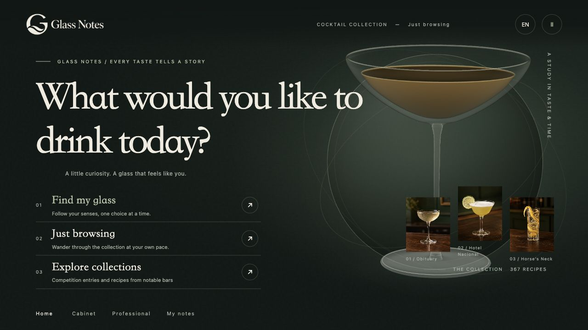
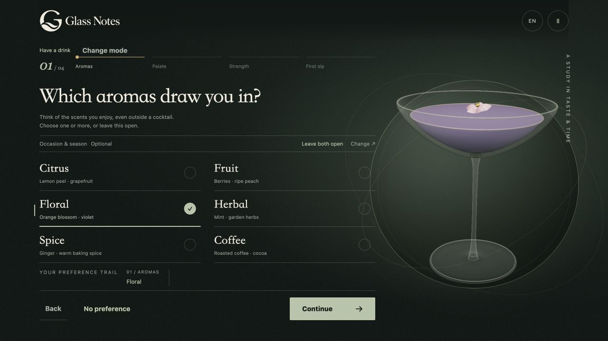
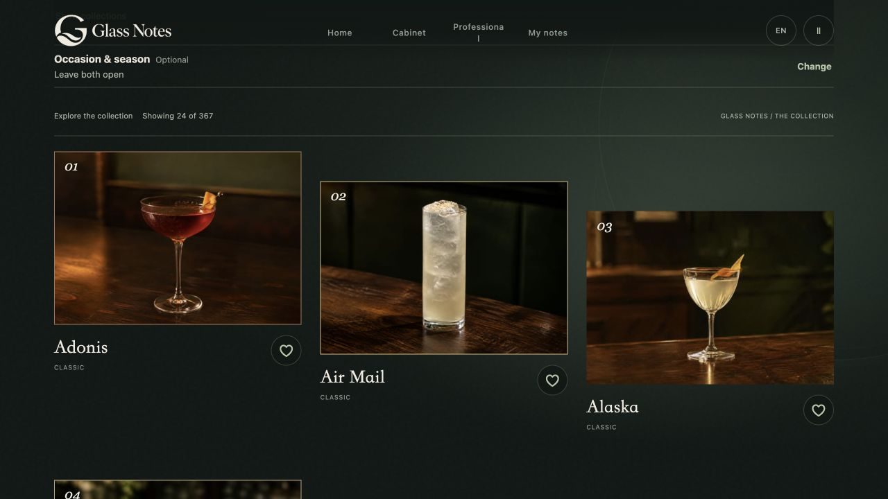
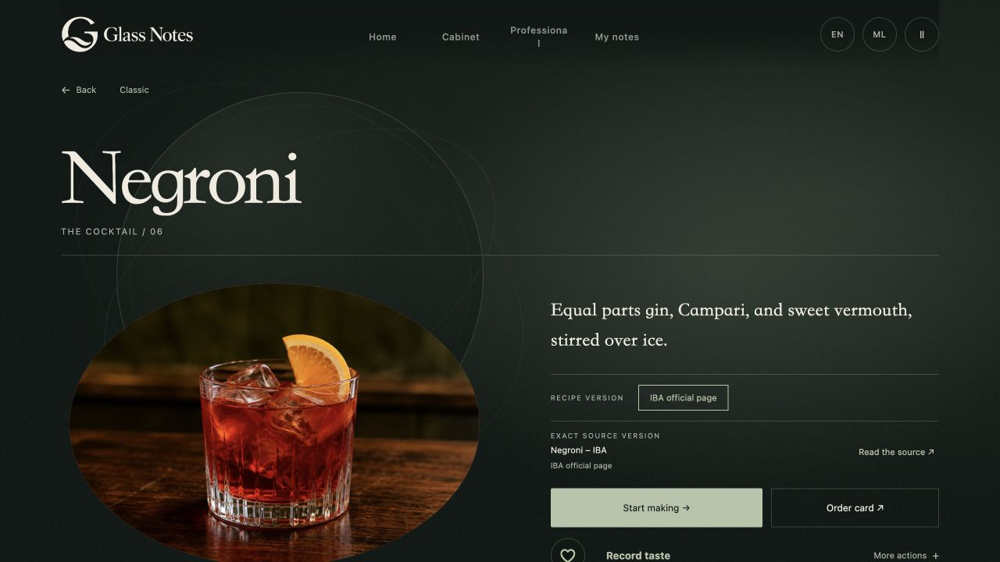
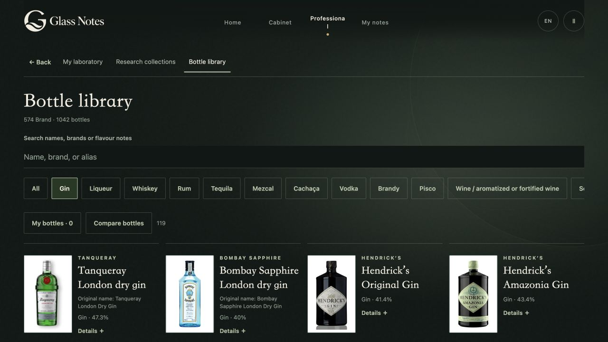
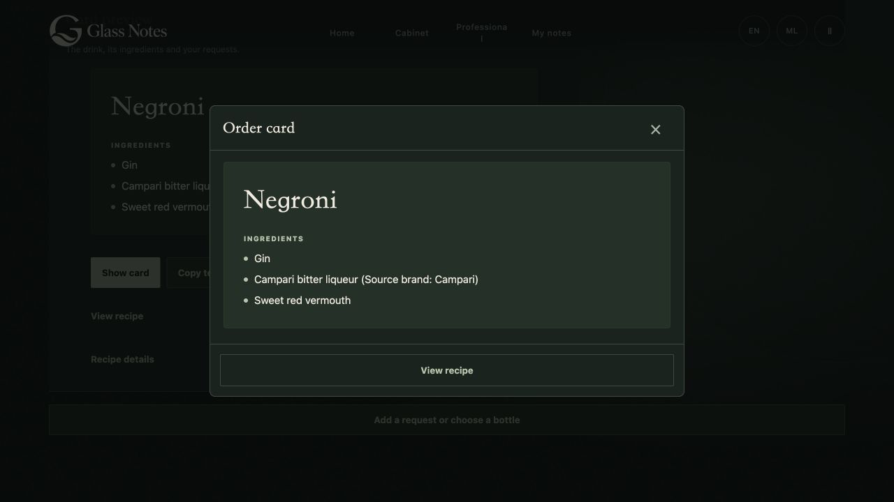
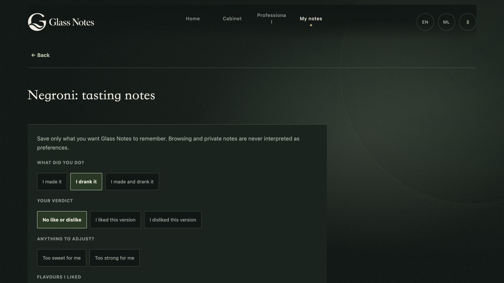

# Glass Notes

[中文](README.md) · English

Find a drink for tonight, make it with what you have, and remember what you enjoyed. Glass Notes is a personal cocktail app for discovering recipes, keeping a bottle cupboard and building your own recipe book, lists and tasting notes.

**367 cocktails · 371 source versions · 1,042 bottles · 8 interface languages**



[Features](#features) · [Get started](#get-started) · [Local data](#local-data-and-backups) · [Development](#development-and-builds) · [Sources and licence](#sources-and-licence)

[Open the website](https://glass-notes.pages.dev/) · [Download Windows / macOS 1.1.0](https://github.com/AlexShen-Oguri/glass-note/releases/tag/v1.1.0)

Use it in a desktop or phone browser, or download the Windows or macOS app. No account is needed, and personal records stay on your device.

## Features

### Choose by taste, or mix with what you own

Start with **Find my glass** on the home screen. Choose a mode, then explore aroma, taste, strength and the first-sip experience. Select several options or skip a question. Occasion, season and your saved taste memory are optional.

Your choices visibly change the glass beside the questions. Citrus, fruit, floral, herbal, spice and coffee bring different garnishes and liquid colours; palate, strength and first sip shape the continuing ripples and liquid movement. These are visual expressions of flavour, rather than an actual recipe or measured alcohol content.

| Have a drink | Mix it myself |
| --- | --- |
| Find something that suits your taste. | Find recipes using the ingredients and bottles in your cupboard. |
| Read the reasons for a suggestion and open its recipe. | **Ready base spirits come first**, then fewer missing ingredients within each group. Recipes missing 3 or more ingredients are excluded; missing items are listed. |

If your cupboard is empty, you can add ingredients or choose by taste first. Before making a drink, check the recipe for quantities, equipment and ingredients that need advance preparation.



Choose **Find my glass** to reveal the recommendations: the questions fade, the coupe moves to the centre and turns, then the results appear. Skip the motion to read the results immediately. Each suggestion retains its matching source version and reasons; the layout adapts to a single drink, a pair or a larger selection.

### Browse a visual catalogue and keep the right version

Search names, aliases and ingredients; filter by base spirit, included or excluded ingredients, flavour, technique or alcohol-free recipes. Browse classics, competition entries and published bar recipes, with optional occasion and season suggestions.

Each cocktail has one card, with its source versions available in the details. Filters find a version that matches all your choices; open the card to read that recipe.

After you save explicit ratings, Discovery uses an on-device statistical model to pick up to five drinks that suit your taste and one new drink within the current filters. Expand a short reason or ask for a different exploratory drink. Text search continues to show ordinary catalogue matches.



Recipe details include ingredients, measures, steps, glassware, garnish, preparation notes and flavour guidance. Compare translated steps with the original text, or open the recipe and image sources.



### Your cupboard, ingredient library and bottle archive

Mark the ingredients and bottles you own so **Mix it myself** can suggest recipes using them.

**Plan additions** compares the new drinks unlocked by one or two ingredients, including drinks that need both additions together. Rank plans by the number of new drinks or by your saved taste. Expand each plan for exact source versions, brand checks and advance-preparation notes. Check quantities and equipment before making a drink.

**Shopping list** merges required missing ingredients from your chosen exact recipe versions, selecting one ingredient for each alternative. Add the current version directly from the recipe detail page, then review, change or remove purchases in the Cabinet. Confirming a purchase adds its material to your cupboard. The list saves locally and is included in full backups; an older backup without shopping preserves your current list. Purchase confirmation records ownership without prices or stock quantities.

The ingredient library groups pure spirit styles into one everyday entry, while flavored, infused and prepared ingredients stay separate. Ordinary saline has one entry; each source recipe retains its concentration and original dose. Legacy names remain searchable, and saved bottles and records are preserved.

Use the ingredient library to explore ingredients and related recipes. Search the bottle archive by product, brand, alias or flavour description; filter by category, inspect images and available strength information, mark ownership or select bottles for comparison.



### Follow a recipe or show an order card

Choose **Start making** to follow the ingredients, steps and practical tips. Progress saves automatically. When you finish, you can make another drink or return to the catalogue.

Twenty reviewed IBA versions have sourced drink-strength estimates and a short or long serving classification. Expand the estimate to see ingredient and bottle assumptions, or add meltwater to compare strengths before and after dilution. The panel identifies missing information.

An order card presents the drink name, ingredients and explicit requests. Use the app language or source language, show the card, copy its text or share text where the platform supports it. Your private tasting notes are not included.



### Favourites, personal lists and taste memory

Favourite a specific recipe, or create a list for a weekend, gathering or tasting session. **Add drinks** opens the same visual catalogue used for browsing, where you can select the exact version to save.

Lists retain a snapshot of the recipe at the time it was added. Read that saved recipe or open the current catalogue version separately. Cards show the drink image and group its saved source versions together.

**Record taste** opens a drink-specific flavour experience. Record whether you drank or made it, liked or disliked the version, found it too sweet or strong, and which aromas you enjoyed. A private note is optional.

Explicit ratings inform Discovery and the taste-ranked cupboard plans. Guided search follows your current answers, with taste memory available as an option.



### Your recipes, including your own photos

Start from scratch, copy an exact catalogue recipe or take a version from the lab. Edit ingredients, quantities, steps, glassware, garnish and notes. Saving changes retains revision history.

Choose a photo for your recipe and save it with the ingredients, steps and notes. Recipe backups include the photo.

### Research topics and your lab

| Tool | What it supports |
| --- | --- |
| Research topics | Explore works by country, competition and bar. Twelve selected Patrón Perfectionists and Angostura Global Cocktail Challenge recipes include measurements, methods, preparations and organizer links. |
| Bottle comparison | Compare product information and create a controlled comparison from scratch or from an existing recipe. |
| Recipe versions | Create projects, edit quantities and methods, copy the next version and compare changes. |
| Trial batches | Preserve the recipe used for a batch; record time, temperature, aroma, palate, appearance, results and next steps. |
| Result comparison | Compare actual batches, continue from a chosen snapshot as a named version or save it to your recipe book. |

Lab entries autosave locally, ready for your next trial.

### Eight languages and responsive layouts

Chinese, English, French, German, Spanish, Korean, Japanese and Italian are available. The initial choice follows supported device languages; use the toolbar to change it. Drink and bottle names follow your chosen language, with the original name below when it differs.

All features are available in desktop and phone browsers. Switch liquid measures between ml and fl oz; other measures keep their original units.

Deep green, ivory, large display type and fine rules connect the home screen, discovery and personal records. Each fresh home visit draws three different drinks from the catalogue with direct recipe links; resizing or changing language keeps that selection. Cocktail images move from the catalogue into recipe details, while flavour choices remain connected to the coupe.

On phones, the coupe has its own content area and scrolls with the page. Home images, question titles and choices follow the content flow, keeping the model clear of text and controls.

Pause motion at any time, or use the system's reduced-motion preference. Continuing animation stops in the background or when the model is offscreen. The screenshots show the running app; some screens have since changed.

## Local data and backups

Favourites, lists, cupboard records, recipes, experiments, making sessions, taste feedback and preferences stay in the current browser or app. They do not sync automatically to other devices.

When moving to another device, open **My notes → Backup & restore** to export a JSON file, then import it on the new device. Review the sections and conflicts in the preview before choosing merge or replace.

- Browser profiles, website origins (protocol, domain or port) and devices have separate storage. Desktop copies and upgrades under the same operating-system user share the stable application data directory.
- Clearing site data, ending private browsing or uninstalling can remove records. Export before migrating.
- Backups include private notes and photos and **are not encrypted**. Keep them somewhere safe and avoid sharing them publicly.
- Replace can remove existing records in selected sections. Review the preview and keep an earlier backup.
- The website needs a network connection to load its pages and resources.

## Get started

The website needs no installation. On Windows, download and run `windows-x64-setup.exe`. On macOS 12+, open `macos-universal.dmg` and drag Glass Notes to Applications; the same app supports Apple Silicon and Intel. Export a backup and quit the old app before upgrading.

The macOS app uses ad-hoc signing and has no Apple notarization. First launch may require **Open Anyway** in System Settings → Privacy & Security. The Windows installer is unsigned. Check the Release's SHA256 sums and download the new installer to upgrade.

### Run from source

Use Node.js 24 and npm:

```sh
git clone https://github.com/AlexShen-Oguri/glass-note.git
cd glass-note
npm ci
npm run web
```

To run the exported website:

```sh
npm run build:web
npm run preview
```

Open http://127.0.0.1:4173. Rebuild after source changes. The preview server is for local testing.

## Development and builds

Expo, React Native and TypeScript share interface and domain code. Phone use targets the website; the Windows and macOS apps use Tauri 2 to load a static Web export. Web and desktop use a Three.js coupe with GSAP transitions. Phones use the website; native mobile development tools and iOS export have been removed. Fonts and catalogue content are bundled. Runtime use requires no application backend, database or model API key.

```sh
npm run browser:install
npm run validate
npm run brand:check
```

Install the locked Chromium before first validation. Validation runs type checks, behaviour and content tests, Web export and desktop/phone-width browser E2E. Phone acceptance also requires actual mobile browsers.

For Windows x64:

```sh
npm run desktop:prepare
npm run desktop:test
npm run desktop:build
```

Use Rust with the MSVC toolchain, Visual Studio C++ build tools and the Windows SDK. The installer targets the current user. Installed use requires WebView2, not Node.js or Expo.

For a universal macOS installer, use Rust and Xcode Command Line Tools:

```sh
rustup target add aarch64-apple-darwin x86_64-apple-darwin
npm run desktop:test
npm run desktop:build -- --target universal-apple-darwin
```

`.github/workflows/desktop-release.yml` builds on Windows and macOS runners when a version tag is pushed or the workflow is dispatched manually. Checks default to Windows installation and marker-file preservation from 1.0.0, and macOS architectures and signing. Publish the artifacts to GitHub Release after verification. Linux packaging is not configured.

Use the [Windows/macOS upgrade acceptance guide (Chinese)](docs/DESKTOP-ACCEPTANCE.md) to verify replacement installs and valid personal-record preservation. It distinguishes the existing CI marker-file/bundle checks from business-data acceptance.

For an independently hosted website:

```sh
npm run release:web
```

This produces a static archive, file hashes and a Caddy configuration example under `release/`. Deploy the contents of `site/` to a static hosting service.

| Directory | Responsibility |
| --- | --- |
| `src/app`, `src/features` | Routes and interface |
| `src/domain` | Search, recommendations, snapshots, calculations and validation |
| `src/content`, `src/media`, `assets` | Recipes, bottles, ingredients, localised content and images |
| `src/platform` | Storage, file selection, recovery and platform adapters |
| `src-tauri` | Windows/macOS host and bounded file bridge |
| `scripts`, `deploy` | Tests, builds, packaging and self-hosting examples |
| `research` | Content maintenance and regression evidence; [index](research/README.md), never loaded at runtime |

Brand sources live in `assets/brand`; Web/desktop entry points generate their icons. Previews and generated reports stay out of Git. Files are named by content; historical saved-data IDs remain stable.

See [architecture](docs/ARCHITECTURE.md), [hosting](docs/HOSTING.md) and [contributing](CONTRIBUTING.md).

## Releases and feedback

See the [1.1.0 release notes and checksums](https://github.com/AlexShen-Oguri/glass-note/releases/tag/v1.1.0) for changes, tested scope and download verification.

For ordinary bug reports, include reproduction steps, platform and version. Do not attach personal backups, credentials or private information.

## Sources and licence

Original application code is licensed under [MIT](LICENSE), copyright 2026 AlexShen-Oguri. Third-party dependencies, photographs, datasets, reference material and trademarks retain their own terms.

Cocktail imagery includes AI-created illustrations, with sources and generation records in recipe details and image manifests. Some drink names use editorial translations. Flavour descriptions and alcohol estimates are for reference.

Redistribution permission for some third-party product photographs remains unconfirmed. Assets shown in README screenshots also retain their own licences. Before reuse, consult [third-party notices](THIRD_PARTY_NOTICES.md), [photo attribution](assets/photos/ATTRIBUTION.md) and the relevant asset records.
