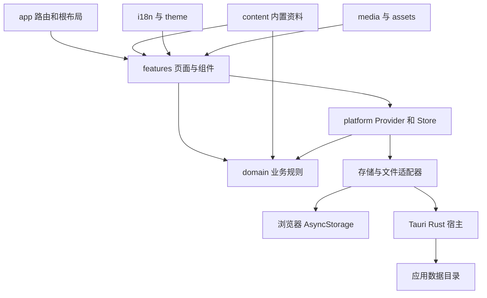
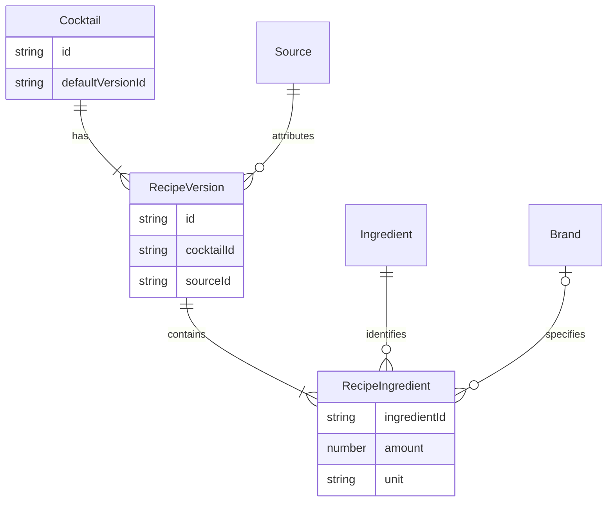
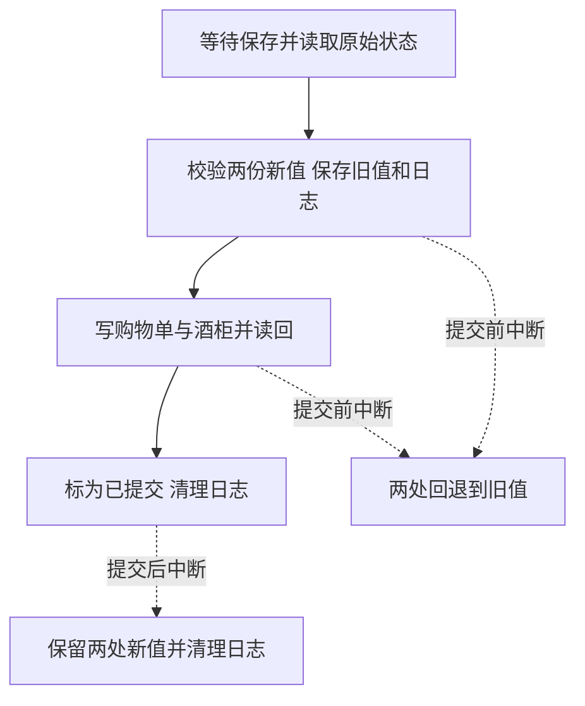
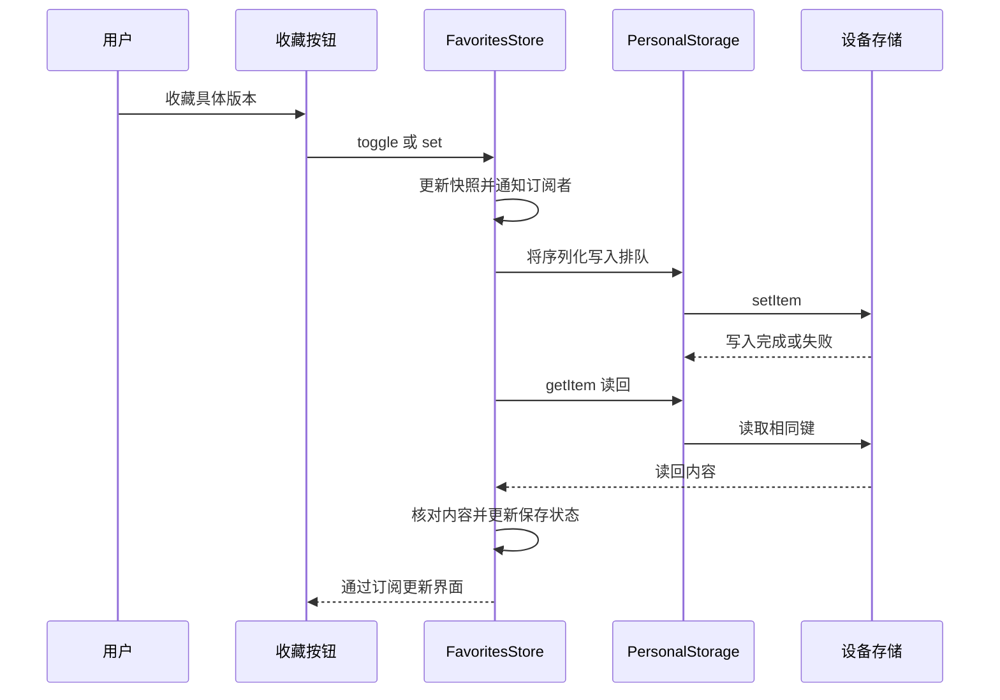

# Glass Notes 中文项目手册

Glass Notes 把鸡尾酒资料、选酒规则和个人记录放在同一个应用里。它的核心由三部分组成：随应用发布的内容目录，在设备上执行的搜索与推荐规则，以及保存到设备上的个人数据。理解这三部分如何连接，你就能从“提出需求让 AI 修改”逐步走向自己判断设计、阅读代码和验证结果。

本手册面向已经参与这个项目、但尚未系统学习软件开发的读者。它既说明功能怎么用，也解释功能为什么这样实现，并提供可以直接阅读和运行的代码入口。

**手册修订于 2026 年 11 月 16 日，适用于 Glass Notes 1.1.0。** 本文以该版本源码为基准，介绍网页端和桌面端共用的功能。

阅读建议：先读功能、架构和数据模型，再沿搜索或收藏的一条调用链看代码，最后动手完成学习练习。遇到术语时，可以先看文末的术语表。

## 目录

- [项目定位与实际能力](#项目定位与实际能力)
- [功能使用与实现对照](#功能使用与实现对照)
- [技术栈与各自职责](#技术栈与各自职责)
- [架构与目录](#架构与目录)
- [从点击到界面更新](#从点击到界面更新)
- [路由与应用启动](#路由与应用启动)
- [数据模型与稳定标识](#数据模型与稳定标识)
- [搜索与筛选原理](#搜索与筛选原理)
- [推荐与口味记忆原理](#推荐与口味记忆原理)
- [酒柜与制作可行性](#酒柜与制作可行性)
- [购物清单与确认购入](#购物清单与确认购入)
- [收藏与酒单的完整调用链](#收藏与酒单的完整调用链)
- [私人配方与实验室](#私人配方与实验室)
- [调制会话与酒精度估算](#调制会话与酒精度估算)
- [点单卡与分享](#点单卡与分享)
- [本地存储与异步错误](#本地存储与异步错误)
- [备份与恢复原理](#备份与恢复原理)
- [多语言与单位](#多语言与单位)
- [专题研究与来源证据](#专题研究与来源证据)
- [图片与来源记录](#图片与来源记录)
- [界面动效与三维酒杯](#界面动效与三维酒杯)
- [跨平台与桌面宿主](#跨平台与桌面宿主)
- [开发构建与发布](#开发构建与发布)
- [测试与问题定位](#测试与问题定位)
- [如何自己修改项目](#如何自己修改项目)
- [学习路径与练习](#学习路径与练习)
- [术语与资料入口](#术语与资料入口)

## 项目定位与实际能力

Glass Notes 服务于一条个人使用流程：找到想喝的酒，确认配方，用手边材料调制，记录体验，再把经验用于下一次选择。

当前运行时目录包含 367 款鸡尾酒、371 个来源版本、1,448 个原始材料记录、1,390 个材料概念、1,042 款瓶装酒、574 条品牌记录和 377 条来源记录。材料概念用于归组，原始 ID 仍保留；专题研究作品另外计数，不自动进入可搜索的酒库。界面支持中文、英语、法语、德语、西班牙语、韩语、日语和意大利语。

网页版运行在电脑和手机浏览器里；Windows 和 macOS 桌面版把同一套 Web 界面装进 Tauri 窗口。原生手机开发工具及 iOS 导出已移除，Expo 继续用于现有网页构建与路由。

应用目前没有账号服务、应用后端、云同步或运行时大语言模型调用。“为我定制”使用规则；“随便逛逛”的个性精选和“更合口味”的补货规划还会从已保存的结构化评价训练小型统计模型。计算在本地完成，自由笔记不参与训练。开发时使用 AI 编程或生成部分图片，与应用运行时的推荐机制是不同的事情。

这个选择带来两个直接结果：核心使用不需要模型密钥或账号；换浏览器、网站来源或设备时，个人记录需要通过备份迁移。网页版首次加载页面和资源仍需要网络，不能把“资料随应用打包”理解成已经实现了可保证离线启动的 PWA。


## 功能使用与实现对照

| 功能 | 如何使用 | 主要实现位置 | 背后的原理 |
| --- | --- | --- | --- |
| 首页三杯 | 从首页图片直接打开一种酒 | `features/welcome` | 从有可用图片和默认版本的酒款中不放回抽取 |
| 为我定制 | 选择“喝一杯”或“自己调”，回答口味问题；可手动开启口味记忆 | `features/guided`、`domain/guided` | 把选择转换为查询，筛选后分层排序 |
| 随便逛逛 | 先看精选，也可搜索并叠加条件浏览完整酒库 | `features/discovery`、`domain/search`、`domain/taste` | 先筛确切版本，再从保存评价学习组合偏好 |
| 配方详情 | 切换来源，查看用量、步骤、出处及可展开的酒度参考 | `features/recipe`、`features/making/RecipeAbv.tsx` | 用确切版本定位配方，按逐行证据推导估算 |
| 酒柜 | 标记材料或瓶款，查看材料齐全、待核对和缺料的酒 | `features/making`、`domain/ingredients` | 用有依据的材料归组和来源行规则匹配 |
| 补货规划 | 在酒柜选择补一项或两项，按“解锁更多”或“更合口味”看方案 | `features/making/PantryRestockPlanner.tsx`、`domain/making` | 比较新增确切来源，分层排序和复用本地模型 |
| 购物清单 | 从配方加入缺料，选替代项，确认买到后同步酒柜 | `features/making/ShoppingList.tsx`、`domain/shopping` | 冻结配方需求，合并同类采购，用恢复日志保护两次写入 |
| 材料库 | 阅读材料资料，查看相关配方 | `features/ingredients`、`domain/ingredients` | 稳定材料 ID 连接资料、配方和酒柜 |
| 瓶款档案 | 搜产品，筛品类，标记拥有，比较瓶款 | `features/workspace`、`domain/bottles` | 产品与材料关联，同时保留品牌、酒精度和来源 |
| 调制 | 阅读材料和步骤，记录本批酒度假设，完成或恢复会话 | `features/making/MakingScreen.tsx` | 冻结配方及实际供给，批次假设与可选行一起保存 |
| 点单卡 | 选择文字语言和明确要求，出示、复制或分享 | `features/order`、`domain/order` | 从已核对来源的配方构造适合展示的文本 |
| 收藏 | 对具体配方版本进行收藏或取消 | `domain/favorites.ts` | 保存版本 ID，跨页面共享状态 |
| 私人酒单 | 创建酒单，将确切版本加入酒单 | `features/favorites`、`domain/favorites.ts` | 保存版本 ID、完整快照和内容指纹 |
| 风味体验 | 记录喝过或调过、喜欢程度、太甜或太烈、香气和笔记 | `features/taste`、`domain/taste` | 结构化反馈可以调整下一次推荐排序 |
| 我的配方 | 从空白、酒库或实验室创建，编辑并保存照片 | `features/private-recipes`、`domain/private-recipes` | 保存来源关系，修改时追加修订记录 |
| 专题研究 | 按国家、赛事、酒吧浏览作品；查看已核对的独立赛事配方 | `features/workspace/research`、`content/topics.ts`、`content/competition-recipes.ts` | 将完整作品、预制和来源缺口分开；专题不等同于酒库 |
| 我的实验室 | 建项目、配方版本和试调批次，记录观察并比较 | `features/workspace/LabScreen.tsx`、`domain/lab` | 分离配方设计与实际试验，批次保留当时快照 |
| 备份恢复 | 导出 JSON，在目标设备导入并查看合并或替换预览 | `features/backup`、`domain/backup`、`platform/personalStorage.ts` | 校验、冲突处理、恢复日志和旧状态保护 |
| 显示偏好 | 切换语言、ml 或 fl oz、暂停动效 | `platform/AppProvider.tsx`、`i18n`、`theme` | 保存偏好，以显示层转换保持业务身份稳定 |

表内路径都位于 `src/` 下。它们是阅读入口，不要求一次读完所有文件。

第一次体验可用内格罗尼串起来：

1. 在“随便逛逛”搜索内格罗尼，打开 IBA 来源，展开酒度参考。
2. 收藏配方并记录一次明确的喜欢或不喜欢，回到发现页观察精选。
3. 在酒柜标记已有材料，比较两种补货目标，展开一个方案核对来源。
4. 从配方加入购物清单，买到后确认购入，再从酒柜检查拥有状态。
5. 开一次调制会话，填写已知的整批融冰水量，保存后导出备份。

首页三杯来自 `WelcomeScreen.tsx` 的本地随机选择。每次抽取都从候选池移除已选项，所以不会重复；切换语言或调整窗口不会重抽，从首页酒图进入详情再返回也会保留选择。这给图片转场一个稳定的返回位置。它与根据口味排序的定制推荐是两套入口。

## 技术栈与各自职责

下面的版本来自当前 `package.json` 声明，精确安装结果由 `package-lock.json` 固定。`^` 和 `~` 是版本范围符号，使用 `npm ci` 时按锁文件安装，而不是自行选择范围内的最新版本。

| 技术 | 当前声明 | 在项目中的作用 |
| --- | --- | --- |
| TypeScript | `~6.0.3` | 描述数据形状，检查函数输入输出和空值 |
| React | `19.2.3` | 组件、状态、上下文和界面更新 |
| React Native | `0.86.3` | 用 `View`、`Text`、`Pressable` 等组件表达共享界面 |
| React Native Web | `^0.21.2` | 将共享组件适配到浏览器 DOM |
| Expo | `~57.0.21` | 网页开发、打包、图片和字体等共享能力 |
| Expo Router | `~57.0.20` | 根据文件组织路由，生成静态页面 |
| Metro | 由 Expo 工具链配置 | 解析模块、选择平台文件、构建依赖图和打包资源 |
| AsyncStorage | `^2.2.0` | 提供异步键值存储接口 |
| Tauri | Rust 侧 `2`，JS API `2.11.1` | 提供桌面窗口和受限宿主命令 |
| Rust | `Cargo.toml` 要求至少 `1.85` | 实现桌面本地文件、存储和系统对话框 |
| Three.js | `0.180.0` | Web 和桌面的三维酒杯、液体和装饰 |
| GSAP | `^3.15.0` | Web 动画时间线和转场 |
| `@gsap/react` | `^2.1.2` | 将 GSAP 的生命周期和 React 组件连接 |
| `pinyin-pro` | `3.29.3` | 将中文转换为拼音，支持搜索容错 |
| Node.js | 开发要求 `24` | 在电脑上执行构建、测试和内容工具 |
| Node Test Runner 与 `tsx` | Node 内置测试，`tsx` 为 `4.23.13` | 直接运行 TypeScript 行为测试 |
| Playwright | `1.64.0` | 在锁定的 Chromium 中验证真实页面和存储流程 |

Node.js 是开发和构建环境，浏览器是 Web 应用的运行环境。终端中的 `npm run build:web` 由 Node 执行，导出的 JavaScript 则由用户的浏览器或桌面 WebView 执行。

### TypeScript 检查什么

项目的 `strict` 和 `noUncheckedIndexedAccess` 开启了较严格的检查。例如 `RecipeIngredient.amount` 是 `number | null`，调用者必须考虑“不知道用量”的情况；数组索引也可能返回 `undefined`。

但 TypeScript 的类型不会替你验证用户导入的 JSON。`JSON.parse()` 后的数据仍需要在运行时检查字段、类型、长度、引用关系和版本号。项目大量 `parse*` 与 `validate*` 函数就是在处理这个边界。类型收窄的基础可阅读 [TypeScript 官方说明](https://www.typescriptlang.org/docs/handbook/2/narrowing.html)。

### React 与 React Native 如何配合

React 决定“当前状态应该显示怎样的界面”；项目继续使用 React Native 组件，并通过 React Native Web 呈现到 HTML 和 DOM。手机浏览器和 Tauri 都加载这一份网页。

这使页面和业务代码可以共享，但文件选择、持久存储、动画及三维渲染仍需要适配。共享代码的目标是保持相同的业务含义，而不是假设所有设备拥有相同的系统能力。

## 架构与目录



这里有四种值得区分的职责：

1. **页面负责交互。** 它知道用户点了什么，哪些控件应该显示。
2. **领域层负责规则。** 它知道一条配方是否满足查询、怎么排序、快照是否有效。
3. **内容层负责资料。** 它提供酒款、材料、产品、来源和翻译。
4. **平台层负责副作用。** 它接触设备存储、文件、照片和系统能力。

“副作用”指改变函数之外的世界，例如写文件、保存数据或打开对话框。许多领域函数仅接收数据并返回结果，适合直接测试；平台函数则需要处理权限、失败和异步完成。

| 目录或文件 | 建议如何理解 |
| --- | --- |
| [`src/app`](../src/app) | 页面的地址与应用启动骨架 |
| [`src/features`](../src/features) | 看得到、点得到的界面 |
| [`src/domain`](../src/domain) | 不依赖具体页面的业务含义 |
| [`src/content`](../src/content) | 发布时随应用带上的资料 |
| [`src/platform`](../src/platform) | 状态保存、恢复和各平台边界 |
| [`src/i18n`](../src/i18n) | 界面文字与语言资源 |
| [`src/theme/tokens.ts`](../src/theme/tokens.ts) | 颜色、圆角等共享视觉变量 |
| [`src/media`](../src/media) | 业务 ID 到图片资源的映射 |
| [`assets`](../assets) | 图片、字体、品牌维护源及来源清单 |
| `public/brand`、`src-tauri/icons` | 入口自动生成的图标，不提交 Git |
| [`src-tauri`](../src-tauri) | 桌面窗口、宿主命令和安装包配置 |
| [`scripts`](../scripts) | 构建、测试、资料加工与发布工具 |
| [`research`](../research) | 离线来源证据和测试所需资料，不导入应用运行时 |
| [`package.json`](../package.json) | 开发命令及依赖声明 |
| [`app.json`](../app.json) | Expo 名称、版本、插件及静态导出配置 |
| [`metro.config.js`](../metro.config.js) | 打包范围，排除研究下载和临时产物 |

完整架构约束见 [ARCHITECTURE.md](ARCHITECTURE.md)。本手册解释原理，架构文档用于维护时核对约束。

### 仓库中什么必须保留

按内容职责组织目录，而不用开发轮次、Agent 名字或阶段编号命名。配方来源分组在 `src/content/recipe-collections/`，品牌维护入口在 `assets/brand/`；不为了模仿其他项目而拆分应用或引入新的包管理层。

| 类别 | 作用与保留方式 |
| --- | --- |
| 应用输入 | `src/`、生产图片/字体、平台配置：运行与构建需要，保留。 |
| 维护和回归输入 | `research/` 的选择记录、翻译层、来源证据、兼容性基线：不在运行时加载，但内容重建与测试需要，保留；每组用途见 [research 索引](../research/README.md)。 |
| 来源和视觉比较 | 瓶图原稿、许可/署名清单用于重建、核对与授权追溯；`assets/bottles/originals/supplier-candidates/` 为可选包装比较照片，应用不加载，保留选定原稿与来源。 |
| 生成输出 | `public/brand/`、`src-tauri/icons/` 由启动/构建入口恢复；品牌预览、原料翻译 worksheet、报告放忽略的 `artifacts/`；构建和缓存同样不提交。 |
| 使用和维护文档 | README、架构、部署、依赖安全、桌面验收、本手册、内容及许可说明不影响应用运行，但帮助复现、维护与复用。过期总结、镜像上游 README 和无调用的任务调度工具无需保留。 |

配方、来源和瓶款 ID 是个人数据中的引用，部分历史 ID 带有 `batch` 后缀。文件重命名不改变这些 ID。AI 图片的真实来源说明也不能为了减少开发痕迹而删除。

品牌维护用 `npm run brand:build` 后核对源和 manifest；正常 `npm run brand:check` 会恢复生成图标并验证源一致性。材料内容重建会改写 runtime JSON，命令及副作用见 research 索引，不要将它作为普通启动步骤。

## 从点击到界面更新

先看一个教学用组件，它不是仓库中的新增功能：

```tsx
function Example() {
  const [selected, setSelected] = React.useState(false);
  return (
    <Pressable onPress={() => setSelected(value => !value)}>
      <Text>{selected ? '已选择' : '未选择'}</Text>
    </Pressable>
  );
}
```

第一次渲染时 `selected` 是 `false`。点击后，事件处理函数请求修改状态，React 再次执行组件，根据新状态更新屏幕。这叫声明式界面：代码描述状态对应的样子，框架负责把现有界面更新到这个样子。[React 状态快照说明](https://react.dev/learn/state-as-a-snapshot)。

阅读本项目组件时，先分清四种数据：

| 数据 | 例子 | 生命周期 |
| --- | --- | --- |
| 输入参数 `props` | 配方 ID、语言、暂停状态 | 由父组件传入 |
| 页面状态 `state` | 当前筛选、弹窗是否打开 | 随页面交互更新 |
| 派生值 | 根据查询计算的搜索结果 | 可从其他数据重新算出 |
| 持久数据 | 收藏、私人配方、实验记录 | 需要存储，重启后再加载 |

`useMemo` 通常用来复用计算结果，避免输入未变时重复计算；它本身不保存数据到硬盘。`useRef` 保存跨渲染的引用或临时标记，修改它通常不会触发渲染。`useEffect` 在提交后连接加载、监听等外部行为，并在必要时清理。不能把它们都理解成“缓存”。

本项目还有 `Provider` 和 `Store`。Provider 让下面的多个页面访问同一份状态；Store 管理数据、订阅者、读写和错误。`useSyncExternalStore` 将 Store 的快照订阅接入 React，使 Store 变化时相关组件更新。

## 路由与应用启动

入口由 `package.json` 的 `main: "expo-router/entry"` 指向 Expo Router。路由采用文件约定：`src/app/discover.tsx` 对应 `/discover`，`src/app/cocktails/[id].tsx` 对应 `/cocktails/具体酒款ID`。方括号表示动态参数。Expo Router 的文件路由规则可见 [官方介绍](https://docs.expo.dev/router/introduction/)。

很多路由文件只转出一个页面组件。例如：

```tsx
// src/app/discover.tsx 的实际内容
export {default} from '../features/discovery/DiscoveryScreen';
```

这是有意保持路由层薄：地址规则放在 `app`，交互实现放在 `features`。旧的 `/find` 地址通过重定向回到 `/discover`，保留旧书签的可用性。

根布局 [`src/app/_layout.tsx`](../src/app/_layout.tsx) 挂载恢复协调器、显示偏好、酒柜、收藏、实验室、瓶款、私人配方、调制、口味和购物 Provider。普通路由切换会保留这些 Store；恢复或确认购入完成后，个人数据代次变化会使相关 Provider 重新读取，导航状态随之恢复。根布局还拥有背景酒杯和全局导航。

启动时先由 `RecoveryProvider` 检查是否有未完成的恢复日志。存储准备好后才挂载业务页面。各 Store 随后加载自己的记录，页面根据加载和错误状态显示相应内容。

一个具体配方地址可以写成：

```text
/cocktails/negroni?version=negroni-iba
```

其中 `negroni` 是酒款，`negroni-iba` 是确切来源版本。查询参数把搜索选中的版本带到详情页，否则可能打开同款酒的另一个版本。

Web 静态导出在构建阶段为已知酒款生成 HTML。`generateStaticParams()` 列出酒款 ID；构建阶段无法知道用户未来地址中的 `?version=`，所以详情路由在首个浏览器帧先显示中性加载状态，等查询参数可用后再展示对应版本，避免短暂显示错误配方和操作。这涉及 hydration：浏览器里的 React 接管构建时生成的 HTML。[Expo 静态渲染说明](https://docs.expo.dev/router/web/static-rendering/)。

## 数据模型与稳定标识

最值得先读的文件是 [`src/domain/contracts.ts`](../src/domain/contracts.ts)。它定义多个模块共同遵守的数据约定。



这是对象关系示意图。代码中的数据是 TypeScript 对象和数组，应用并未使用关系数据库。

### 酒款与配方版本

`Cocktail` 保存酒款卡片身份、名称、别名、默认版本和版本列表。`RecipeVersion` 保存一个具体来源的用量、步骤、杯型、装饰、风味、翻译状态和出处。一个酒款可以有多个不同来源版本，不能把来源差异压成一份通用配方。

例如当前内格罗尼的 IBA 版本包含以下真实字段节选：

```ts
{
  id: 'negroni-iba',
  cocktailId: 'negroni',
  sourceId: 'iba-negroni',
  ingredients: [
    {ingredientId: 'gin', amount: 30, unit: 'ml'},
    {ingredientId: 'campari', amount: 30, unit: 'ml', brandId: 'brand-campari'},
    {ingredientId: 'sweet-red-vermouth', amount: 30, unit: 'ml'},
  ],
  flavours: ['citrus', 'herbal'],
  tastes: ['bitter', 'sweet', 'dry'],
  profileBasis: 'editorial',
}
```

材料名字在 `Ingredient` 中，通过 ID 查找；配方行只存所需材料 ID 和具体用量。这减少重复，也让多语言名称、材料搜索和酒柜拥有关系共用同一个身份。

### 材料 品牌与瓶款

材料描述“配方需要什么”，品牌描述“来自谁”，瓶款描述“具体什么产品”。一款瓶装金酒可以通过 `ingredientIds` 与配方中的金酒材料关联，但品牌要求仍需要单独核对。

材料概念 `MaterialConcept` 给一组已审阅的原始 ID 一个主入口；来源行要求 `RecipeMaterialRequirement` 只对某个版本内未改变的那一行生效。例子：纯基酒风格可共用一个酒柜入口，风味浸泡酒独立；普通盐水可共用入口，原配方里的浓度和用量照常显示。分类父子关系、同名和别名不能自行证明等价。详见[酒柜与制作可行性](#酒柜与制作可行性)。

### ID 与名字

名字属于显示信息，ID 属于关系身份。改中文译名通常无需更换 ID；更换 ID 却会影响收藏、酒柜、快照和旧备份。维护规则要求保持酒款、来源版本、材料和瓶款 ID 稳定。

`snapshotName` 为旧个人快照保留稳定的名称基础。显示翻译可以改善，但不能因此悄悄改变原有配方指纹或用户自己写的标题。

### null 与未知

`amount: null` 表示没有可靠的数值，`strength: null` 表示酒感未分类，`compositionKnown: false` 表示材料成分未知。未知不会自动等于零、无酒精或可以通过排除筛选。这种区别是很多可靠业务规则的基础。

## 搜索与筛选原理

阅读入口是 [`src/domain/search/index.ts`](../src/domain/search/index.ts) 和 [`text.ts`](../src/domain/search/text.ts)。`searchCocktails(catalogue, query)` 接收目录与查询，返回酒款结果及满足条件的版本列表。

### 结构化条件如何组合

不同筛选维度共同约束同一个版本。通常，同一维度多选表示匹配其中之一；材料包含可以显式选择 `all` 或 `any`，默认是 `all`。

| 条件 | 当前含义 |
| --- | --- |
| 多种基酒 | 命中其中一种；`none` 还会检查版本的无酒精酒感分类 |
| 多种风味或口感 | 标签存在交集 |
| 多种手法 | 命中至少一种有原步骤证据的手法 |
| 包含材料 `all` | 所选材料都在配方行中 |
| 包含材料 `any` | 至少一个所选材料在配方行中 |
| 排除材料或类别 | 配方不得包含被排除项；成分未知时不能当作已证明符合 |
| 经典 赛事 酒吧 | 检查酒款类别及版本自己的来源信息 |

搜索材料时检查配方明确列出的 ID，包括可选材料，不自行推断替代品。酒柜判定采用另外的材料解析规则；“手边材料可用于这杯”与“来源配方明确写了这个材料”是两个问题。手法也不从中文步骤中的一个词猜测，而是使用来源版本对应的 `mixingMethods` 证据，检查其引用的原步骤索引是否有效。

### 为什么必须在一个版本内匹配

假设一款酒有两个教学用版本：A 含金酒与柠檬，B 含朗姆与青柠。查询“金酒并且包含青柠”时，两者都不满足；程序不能从 A 取金酒、从 B 取青柠后宣称这款酒匹配。

实现上，程序逐个检查酒款拥有的版本，仅收集全部条件都满足的版本。结果还保存 `selectedVersionId`，详情页继续使用这个版本。若默认版本也匹配，就优先选默认版本，否则选匹配列表中的第一个。

这个规则是业务不变量：无论以后界面怎么变、排序怎么优化，都必须成立。

### 文本搜索为何能处理拼音与错字

文本首先经过 Unicode 规范化、去组合音标、小写化和空白处理。随后匹配名称、别名、材料与品牌等字段，按以下等级评分：

| 匹配等级 | 当前分数 |
| --- | --- |
| 完全一致 | 100 |
| 单词边界前缀 | 90 |
| 子串 | 80 |
| 拼音 | 70 |
| 受限制的近似读音 | 60 |
| 拼写误差 | 50 |

拼音来自 `pinyin-pro`。拼写容错使用编辑距离：插入、删除、替换、相邻交换各需要多少步才能把一段文字变成另一段文字。容错有长度和差异限制，避免很短的输入匹配大量无关记录。

多个查询词需要全部命中，但可以分布在不同字段；基础函数按最弱的词匹配等级评分。

上表是 `scoreTextSearch()` 的基础分，搜索结果的 `score` 还包含字段权重。`textMatch()` 先选基础匹配等级最高的字段组，同等级时优先酒名、别名、材料或品牌、组合字段；随后计算“基础分 + 字段权重 × 100”。酒名、别名、材料或品牌、组合字段的权重分别为 4、3、2、1。因此完全匹配酒名会得到 `100 + 4 × 100 = 500`，下面的内格罗尼示例返回 500 是正常的。

普通结果按这个最终文本分排序，再考虑经典类别和稳定 ID。搜索没有向量数据库或远程搜索服务。

### 可运行的搜索观察

在仓库根目录、完成 `npm ci` 后执行：

```sh
node --import tsx --input-type=module <<'JS'
import {catalogue} from './src/content/catalogue.ts';
import {searchCocktails} from './src/domain/search/index.ts';

const results = searchCocktails(catalogue, {
  text: 'negroni',
  ingredientIds: ['gin', 'campari'],
  ingredientMode: 'all',
  locale: 'zh',
});
console.log(results.slice(0, 5));
JS
```

这里先脱离界面观察返回数据。接着读 `DiscoveryScreen.tsx`，查找它如何构造查询、调用搜索、根据结果渲染卡片，以及如何把选中版本传给路由。

## 推荐与口味记忆原理

项目有两条推荐路径。问答式的“为我定制”用固定规则排序，默认关闭口味记忆；“随便逛逛”的个性精选用本地统计模型，也把评分能力提供给补货规划。两条路径都先检查明确条件，再对合法的来源版本排序。

### 问题流程使用状态机

[`src/domain/guided/session.ts`](../src/domain/guided/session.ts) 的 `guidedReducer` 处理 `toggle`、`next`、`back`、`skip`、`begin` 和 `finish` 等动作。状态包含：

- `draft`：当前还在修改的选择。
- `submitted`：提交时复制出来、用于真实搜索的选择。
- `phase`：`choosing`、`revealing` 或 `results`。
- `step`：当前问题位置。
- 场合与季节的草稿及已提交值。

状态机把允许的变化写成显式规则。例如在最后一步才可以 `begin`，跳过当前问题会删除该问题条件，而不是留下之前的旧选择。提交立即生成查询副本，结果计算不等待酒杯转场完成。

### 场合与季节排序

[`src/domain/context/index.ts`](../src/domain/context/index.ts) 通过整理过的版本证据匹配场合和季节。每匹配一个维度增加一个场景分数，先按场景分数分层，再在同层应用口味记忆。这些标签属于编辑指导，不是模型现场推理或来源作者的统一推荐。

部分场景结果还会做多样性重排：在同一场景分层内，为前部结果增加不同基酒、主要香气和经典酒的覆盖。多样性逻辑重排结果，不会把不满足筛选的酒加入候选。

### 为我定制的记忆权重

手动开启口味记忆后，[`rankWithTaste()`](../src/domain/taste/index.ts) 先调用普通搜索，再检查已保存的结构化体验。下面是这条路径的规则分，不是发现页的模型分数。

| 证据 | 当前记忆分变化 |
| --- | --- |
| 喜欢当前这个确切配方快照 | `+12` |
| 不喜欢当前这个确切配方快照 | `-12` |
| 配方含一种明确喜欢的香气 | 每种 `+2` |
| 曾反馈太甜，候选带甜味标签 | `-2` |
| 曾反馈太烈，候选为 strong | `-2` |

例如用户喜欢某一确切版本，偏爱草本，又有太甜反馈；该候选含草本和甜味标签，它的记忆分是 `12 + 2 - 2 = 12`。这只解释记忆分，最终名次还受场景分层、酒柜分层及适用的多样性重排影响。

对确切版本的喜欢或不喜欢，需要版本 ID、来源和配方指纹都匹配，避免旧配方评价直接覆盖后来变化的配方。同一身份有多个记录时使用最新记录。香气偏好和太甜、太烈反馈则可形成跨配方信号。

自由文字笔记会被保存，评分只读结构化字段。“喝过”或“调过”也不会自动被解释为“喜欢”。

### 随便逛逛如何学习口味

阅读入口是 [`recommendations.ts`](../src/domain/taste/recommendations.ts) 和 [`PersonalDiscovery.tsx`](../src/features/discovery/PersonalDiscovery.tsx)。页面只把成功保存的 `savedState` 交给领域函数；未保存的草稿不会立即改变推荐。

1. **选评价。** 按版本 ID 与冻结配方指纹取各自最新记录，最多使用最近 1,000 个有明确信号的快照。整杯喜欢或不喜欢是主信号，明确香气与太甜、太烈是较低权重的信号。中性、没勾选、仅浏览或仅记笔记都不会变成负样本。
2. **把配方转成特征。** 120 维向量表示香气、口感、材料、组合和可比较的配比。比如“金酒＋柑橘”的组合能跨酒款共享证据。未知用量或不可比单位不硬转。多个组合可能映射到同一位置，所以解释要回看真实的共同材料和评价。
3. **从评价拟合分数。** 贝叶斯岭回归给每个特征一个权重。可把它理解为“输入特征的加权和拟合评价；证据少时让权重靠近零”。计算还估计分数有多不确定。这个分数是内部排序用的效用，不能解读为喜欢的概率。
4. **先筛选再选杯。** 硬条件限制确切来源；同款酒不重复。候选充足时，先按后验平均分选五杯，同时扣除与已选项的相似度（MMR）；再从合格、没有体验记录的酒款中，用一次共享的 Thompson 后验抽样尝试选一杯探索。若没有合格探索项，可以用普通候选补位，但不把它标作探索；候选总量不足就少选。没评价时仍可普通浏览。
5. **保持结果稳定。** 会话种子、探索轮次与上次探索选择存在 `sessionStorage`，让返回详情、刷新、加载更多时不随机洗牌。“再探索一杯”只换探索位。已保存评价的编辑、删除或备份恢复会重新推导模型；不保存模型参数。

一个直观对比：只用固定规则，“我喜欢这杯金酒＋柑橘”主要影响这份确切配方和显式香气；组合模型可以给另一份含相似组合的合法配方一些支持，但不会从一次评价推断你喜欢所有金酒。

有文本搜索或正在给私人酒单选酒时，页面保留普通结果，不插入精选。推荐理由默认收起，展开可查看简短依据；口味读取失败仍能浏览酒库。另有描述性的口味画像，用于查看哪些明确反馈支撑偏好，不展示模型系数或宣称预测准确率。

### 自己调的排序顺序

[`src/domain/guided/pantry-ranking.ts`](../src/domain/guided/pantry-ranking.ts) 的顺序是：

1. 使用相同搜索规则找出符合查询的版本。
2. 对照酒柜，排除缺少 3 种及以上必需材料的版本。
3. 将必需基酒齐全的候选放在前面。
4. 同组按缺料数量由少到多排序。
5. 在同一酒柜层级内，继续应用场景和口味记忆排序。

因此“喜欢但缺基酒”的配方不会凭喜好分跳过“基酒齐全”的层级。程序使用分层排序，而不是把所有因素随意加成一个总分。最终卡片布局只影响呈现，不改变选中的版本。

## 酒柜与制作可行性

酒柜的“我的材料”记录你标记的材料与瓶款，“能做什么”列出可用配方。[`mergeOwnedPantry()`](../src/domain/ingredients/presence.ts) 合并已拥有瓶款的材料及品牌，`evaluateOwnedVersion()` 用同一个来源行解析器逐条检查配方。

### 材料归一如何保留来源差异

[`resolveRecipeMaterial()`](../src/domain/ingredients/canonical.ts) 先按确切版本、行号和原行内容查找审阅过的要求，再查你拥有的材料。它区分原 ID 命中、同组纯基酒风格、明确等价或替代，以及缺失。没审阅的材料只按原 ID 检查。

教学例子：来源 A 明确允许“材料 X 或材料 Y”，只拥有 Y 就能满足那一行；来源 B 只列 X，同一瓶 Y 不会因此满足 B。A 的原行一旦改了品牌、用量或其他指纹字段，旧的替代规则不能无条件套用。若来源为 X 指定品牌，规则只约束原有候选组，不把品牌要求错误传给明确允许的另一种材料。

显示时可以并列主材料入口、原文和实际使用项。这样能减少找材料的负担，又保留浓度、用量、风格和来源证据。读老酒柜不批量改写旧 ID。

它会分别记录必需缺料、可选缺料、缺失基酒、尚未确认的品牌要求和预制说明状态。当前拥有检查主要产生这些状态：

| 状态 | 含义 |
| --- | --- |
| `missing` | 有必需材料尚未标记拥有 |
| `preparation-check` | 材料齐，但预制资料还需要检查 |
| `brand-check` | 材料齐，但来源指定的品牌尚未确认 |
| `ready` | 拥有检查中的上述要求已满足 |

`ready` 的范围是这套拥有检查。它不能证明酒瓶剩余量足够、器具已经备好或来源的未知成分已经解决。可选材料缺少不计入必需缺料数；同一材料重复出现时，缺料集合会去重。

当前酒柜把结果合成三组：材料齐且通过检查、材料齐但需要核对品牌或预制、缺料。判断某个方案时保留确切来源及可选缺料；同一酒款的多个来源不会被加成多杯。

### 补货规划的两种目标

打开酒柜的“补货规划”（`/pantry?tab=planning`），选择补一项或两项；也可明确添加配方条件、场合或季节。页面不会偷偷继承其他页面的筛选。展开方案可以核对酒款、来源、品牌和预制。

1. **枚举合法方案。** [`rankPresenceCombinations()`](../src/domain/making/presence-decisions.ts) 收集缺料行的可购候选，枚举单项和无序两项组合。每项必须对至少一个实际新来源有贡献；配方只缺可选项时不会制造购物需求。
2. **比较新增覆盖。** 先用完整酒库判断哪些酒款已被任一来源覆盖，再对新增候选应用筛选。已覆盖的酒不会因筛选隐藏它的旧来源就变成新收益。两项方案还会区分哪杯必须两项一起买、哪杯单买一项就能做。
3. **按目标排序。** 默认“解锁更多”比较新增杯数；两种目标都优先材料齐全、再看所选场景。在合适层级内，“更合口味”调用发现页共享的 `scoreTasteVersions()`，每款只取一个合法来源，并汇总正的平均效用。它用稳定的均值，不抽取探索位；没有已保存证据或读取失败时回到数量目标。

规划器在页面内分别缓存候选枚举、模型评分、场景和最终结果。搜索采购材料名称、翻页时不用重训；酒柜、品牌、目录、评价或场景改变时，依赖这些输入的缓存会更新。这个结果可以随时重算，不写库存，不保存模型。

### 拥有状态与实际用量

领域层还有量化库存和消耗计算，例如 `evaluateVersion()`、`planConsumption()`、`applyConsumption()`。量化库存要跟实际供给对应：两行用同一瓶时要累计占用；多条旧库存记录同时映射到一个瓶款时不能擅自相加。当前调制页的完成按钮保存会话完成状态，不调用库存扣减。读代码时要区分领域支持的计算和页面实际提供的动作。

阅读入口：[材料拥有规则](../src/domain/ingredients/presence.ts)、[酒柜页面](../src/features/making/PantryDecisionScreen.tsx)、[个性化规划](../src/domain/making/personalized-planning.ts)。

## 购物清单与确认购入

在配方详情先选来源，再点主动作区的“加入购物单”；保存成功后打开酒柜的“购物单”（`/pantry?tab=shopping`）。补货规划回答“买什么能解锁更多选择”，购物清单回答“为我选定的配方，哪些缺料要买”。发现页卡片本身不提供加入清单按钮。



### 一条采购项如何形成

[`addShoppingTarget()`](../src/domain/shopping/index.ts) 保存配方快照、来源行和当时可购候选，只为缺少的必需行生成采购项。若一行允许 X 或 Y，就选一个；同一材料被两个配方需要时，合并为一项，仍能看到各自对应的配方行。移除采购项会排除对应需求；读取清单不按新酒库重算旧选择。已购标记有专门的确认流程，不能由普通编辑改变。

### 为什么确认购入要写两处

界面上点一次确认，数据上却要同时完成“清单标为已购”和“酒柜标为拥有”。如果只保存第一处就崩溃，两个页面会互相矛盾。[`purchaseShoppingItem()`](../src/platform/shoppingPurchase.ts) 复用恢复事务：

1. 等待正在保存的个人数据写完，读取所有分类的原始状态。
2. 根据已保存清单计算购物和酒柜的新值，校验两份结果。
3. 在锁内核对原始状态与代次，保存旧值及日志，写入两处并读回核对。
4. 中断时，尚未提交就回退两处；已提交就保留两处。重复确认同一已购项不会再补写酒柜，即使后来你主动取消拥有。

这种设计称为幂等：对同一已成功的操作再次请求，不会重复产生副作用。确认购入增加材料拥有关系，不登记实际瓶款、剩余量或实时价格。

## 收藏与酒单的完整调用链

这个流程适合学习项目中“共享状态如何持久化”。从 [`FavoriteButton.tsx`](../src/features/favorites/FavoriteButton.tsx) 开始，再读 [`FavoritesProvider.tsx`](../src/platform/FavoritesProvider.tsx) 和 [`domain/favorites.ts`](../src/domain/favorites.ts)。



`FavoritesStore` 处理几个容易忽略的情况：

**加载尚未结束时点击。** 设备读取是异步的。用户先点击收藏、旧数据稍后才读到，如果简单用旧数据覆盖当前状态，刚才的操作就会消失。Store 会记录明确的用户意图，在加载结束后重放。

**快速连续操作。** 多次写入进入队列，避免较旧写入晚完成而覆盖较新结果。

**界面更新和保存完成。** 收藏按钮可以先反映操作，但持久化仍有 `saving` 和 `error` 状态。写入后还要读回核对；写失败不能当作已经安全保存。

**未知版本 ID。** 新旧目录可能不同，Store 将当前可展示版本和未知版本分别记录，避免简单丢弃无法展示的历史引用。

### 普通收藏与酒单快照

普通收藏主要保存版本 ID。私人酒单条目还保存 `MakingRecipe` 快照、添加时间和指纹，供你查看当时加入的确切配方。

如果配方后来从 30 ml 改为 25 ml，引用当前酒库会看到新用量；保存的快照仍能显示旧用量。这两个视图各有用途，程序保留区别。

### 指纹的作用

`recipeFingerprint()` 先校验配方快照，再对规范化后的内容生成 SHA-256 指纹。规范化 JSON 使对象键的表示顺序稳定，减少仅因序列化形式不同产生的差异。相关实现是 [`canonical.ts`](../src/domain/backup/canonical.ts)。

指纹用于判断“内容是否相同”，不是加密，也不证明来源真实性。ID 相同但指纹不同，表示同一个身份下的内容已变化；恢复、口味反馈和会话匹配都需要考虑这种情况。

## 私人配方与实验室

### 我的配方保存修订

`PrivateRecipe` 拥有自己的 ID、来源和修订数组；`activeRevisionId` 指向当前使用的修订。每次保存修改会追加修订，保留历史内容。

来源有三类：自己从空白写成、从酒库具体版本复制、从实验室版本或批次复制。复制来的记录保留出处和复制时的内容快照，之后用户修改的是自己的配方。

这类似文档版本管理，但它管理的是业务数据。Git 保存代码和文件的开发历史，私人配方修订保存用户在应用中的编辑历史，两者不能互相替代。

阅读入口：[私人配方类型](../src/domain/private-recipes/types.ts)、[领域操作](../src/domain/private-recipes/index.ts)、[存储](../src/platform/privateRecipeStore.ts)。

### 实验室区分设计与实际批次

一个 `LabProject` 可以包含多个 `LabVersion` 和多个 `LabBatch`。版本描述计划配方，批次描述实际试调，并包含温度、时间、香气、口感、外观、结果和下一步等观察。

批次的 `versionSnapshot` 是关键：你试调第一版后，再把第一版编辑为另一种比例，过去那次试调仍然保留原来的内容。只有这样，结果比较才有解释基础。

可以把实验室理解成以下关系：

```text
项目：比较两款金酒
  配方版本 A：产品 A 与既定材料比例
  配方版本 B：产品 B 与既定材料比例
  实际批次 1：当时使用的 A 快照与观察
  实际批次 2：当时使用的 B 快照与观察
```

版本命名和数据比较帮助控制变量；文字观察依然由用户填写，不是应用自动测量或模型评分。实验室修改自动保存，私人配方在 Save 时追加修订，二者的保存语义不同。

阅读入口：[实验室类型](../src/domain/lab/types.ts)、[实验室规则](../src/domain/lab/index.ts)、[LabProvider](../src/platform/LabProvider.tsx)。

## 调制会话与酒精度估算

### 会话保存什么

`MakingSession` 保存 ID、配方快照、指纹、份数、时间、完成状态和酒度假设。从配方进入时会优先找对应的未完成会话；也可以通过会话 ID 直接回到历史记录。来源发生变化时，页面仍能从已保存会话读取当时的配方。

调制存储写 schema 2，沿用原存储键，并继续读取 schema 1。新会话分别冻结来源行标签、允许的材料与品牌范围、实际供给绑定；这些信息独立于配方指纹。旧会话仍按保存时的精确匹配规则解释，不在读取时批量迁移。

[`MakingScreen.tsx`](../src/features/making/MakingScreen.tsx) 显示用量、步骤和提示；有多个合法实际供给时可以选择。酒度面板里的可选材料纳入状态复用 `checkedRows`，与整批假设一起保存，它不是逐步制作进度。完成按钮保存 `completed: true`，已完成会话不可编辑；“再调一杯”用已保存的配方规则创建新批次。

### 份数与单位转换

`scaleRecipe()` 按“目标份数 ÷ 来源份数”缩放明确的数值用量。`top` 和 `part` 等单位不能盲目按普通体积处理，未知用量也不会补成一个猜测数。

ml 和美制 fl oz 的换算采用：

```text
1 fl oz = 29.5735295625 ml
```

`formatAmount()` 根据显示偏好转换液体单位，其余单位保留原有含义。这属于显示转换，不会因此改写来源配方。

### 酒度参考从哪里来

配方详情和调制页通过 [`RecipeAbv.tsx`](../src/features/making/RecipeAbv.tsx) 调用 [`analyzeDrinkStrength()`](../src/domain/making/drink-strength.ts)。默认显示融冰前参考；展开“计算与假设”可看逐行体积、酒度、实际瓶款、来源、市场、核对日期和未知项。

| 输入 | 规则 |
| --- | --- |
| 酒度 | 明确填写值优先；否则按实际瓶款或审阅过的代表样例。已选瓶酒度未知时保留未知，不借别瓶的数据。 |
| 体积 | 通用换算只接受 ml 与美制 fl oz。滴、补满、固体等只有明确的来源行假设或手动输入才纳入。 |
| 可选材料 | 默认不参与；明确纳入才计入。空值与手动输入零是不同状态。 |
| 融冰水 | 用明确输入的整批 ml 计算稀释后参考；没有水量时只给融冰前值。 |
| 短饮与长饮 | 独立的编辑分类，有解释及来源，按版本、来源和完整指纹匹配；不会从酒度或杯型反推。 |

[`drink-strength.ts` 内容表](../src/content/drink-strength.ts) 为 20 个确切 IBA 版本保留分类和必要的假设，包括 Negroni、Jungle Bird、Three Dots and a Dash。表中有 44 条材料参考及 14 条针对特定配方行的体积假设。代表瓶款范围不是从整个瓶库取最低和最高；例如某行的果汁按 0% 建模，也不等于测量过实际饮品。没有足够信息时，输出缺项而不是一个假精确数字。

### 用内格罗尼手算一次

```text
纯酒精体积 = Σ 每种液体体积 × 该液体酒精度 / 100
混合酒精度 = 纯酒精体积 / 液体总体积 × 100%
```

在当前 IBA 版本的参考下界，三行各 30 ml，酒度分别是 40%、24%、16%。纯酒精为 `12 + 7.2 + 4.8 = 24 ml`；融冰前为 `24 / 90 ≈ 26.7%`。若加 30 ml 水，总体积增至 120 ml，下界变为 `20%`。同样计算参考上界，页面约显示融冰前 `26.7–29.1%`、该融水条件下 `20.0–21.8%`。这些数值只适用于该参考和假设，不是实测。

```sh
node --import tsx --input-type=module <<'JS'
import {catalogue} from './src/content/catalogue.ts';
import {bottles} from './src/content/bottles.ts';
import {drinkStrengthContent} from './src/content/drink-strength.ts';
import {recipeSnapshot} from './src/domain/making/index.ts';
import {analyzeDrinkStrength} from './src/domain/making/drink-strength.ts';

const recipe = recipeSnapshot(catalogue, 'negroni-iba');
if (!recipe) throw new Error('Recipe not found');
const result = analyzeDrinkStrength(
  recipe, catalogue, bottles, drinkStrengthContent, {dilutionMl: 30},
);
console.log(result.format?.format, result.beforeIce, result.diluted);
JS
```

详情的选瓶和输入只在页面内模拟，切来源时重置。调制页使用会话冻结的供给，可明确保存整批体积、酒度、融水及可选行；只改融水不会改实际瓶款。保存失败后重试原请求，确认写入成功才显示已保存。原来的领域函数 `calculateAbv(session)` 仍保留；读当前面板应从 `analyzeDrinkStrength()` 开始。

## 点单卡与分享

[`buildOrderCard()`](../src/domain/order/index.ts) 从确切配方快照和用户明确填写的要求构造卡片。它先验证快照及来源，再核对所选瓶款是否对应配方材料；来源指定品牌被换成其他品牌时，单独标记品牌替换。

点单内容可按应用语言显示，也可在原步骤可用时采用来源语言。来源语境下的 `originalSteps` 仍以内容记录的改写和署名约定为准，不能因为字段带 original 就认定是整段逐字引用。

当前简洁卡片主要显示酒名、原名、材料、来源品牌和明确要求。`formatSimpleOrderCard()` 主动省去配方用量、完整步骤和技术诊断字段。完整数据构造与简洁展示分开，使同一份配方能服务不同场景；私人风味笔记没有进入卡片输入。

复制和分享在 `platform/orderShare` 适配。Web 使用浏览器 clipboard 与 share 能力，从点击事件直接调用以保留用户激活；平台不支持或权限失败时返回 unavailable，用户取消分享则返回 cancelled。这些不同结果让页面可以提供恰当反馈，而不是统一宣称已分享成功。

## 本地存储与异步错误

### 三个平台共用接口

项目用一个很小的接口表达存储能力：

```ts
interface LocalKeyValueStorage {
  getItem(key: string): Promise<string | null>;
  setItem(key: string, value: string): Promise<void>;
  removeItem?(key: string): Promise<void>;
}
```

业务 Store 只需知道怎么读写键，不需要知道操作系统的文件路径。浏览器使用 AsyncStorage 的 Web 实现；Tauri 的 WebView 通过同样的接口转为宿主命令。

这叫适配器：把不同平台的能力包装成同一份合同。平台选择位于 [`storage.ts`](../src/platform/storage.ts)、[`storage.web.ts`](../src/platform/storage.web.ts) 和 [`storageFactory.ts`](../src/platform/storageFactory.ts)。

### 数据保存在哪里

浏览器端 AsyncStorage 的 Web 实现使用浏览器本地存储。存储归属于网站来源，即协议、主机名和端口的组合。例如开发地址和生产网站拥有不同数据，`http` 与 `https` 也不共享同一来源。浏览器配置及设备之间同样不会自动迁移。[MDN 本地存储说明](https://developer.mozilla.org/en-US/docs/Web/API/Window/localStorage)。

桌面宿主使用稳定应用标识 `com.glassnotes.desktop` 对应的系统应用数据目录，在 `data` 子目录保存白名单键的 JSON 文件。具体根路径由 Tauri 按操作系统解析，前端不自行拼接用户路径。

### 业务键与恢复键

[`PERSONAL_KEYS`](../src/platform/personalStorage.ts) 定义 10 类记录：偏好、收藏及酒单、酒柜、拥有瓶款、实验室、私人配方、备份引用、调制会话、口味体验和购物清单。恢复另需数据代次、日志和 11 个 before-image 槽位（0 到 10），总计 23 个宿主允许的键。

键名里的 `v1` 是持久身份的一部分，不能看到新 schema 就直接更名。例如收藏键仍为 `glass-notes.favorites.v1`，内部数据格式已经是版本 2。更改键需要迁移，否则用户会看见“数据消失”。

### Promise 与 await

文件或存储操作不能立即保证完成，异步函数返回 Promise。`await` 等待结果后再继续当前函数；失败会抛出异常，需要明确处理。

可以把错误分成三个不同事实：

- `null`：这个键尚不存在，可以按新用户处理。
- 读取或解析失败：数据可能仍在，不能用空数据覆盖。
- 写入失败：界面当前值可能已变化，但设备上的保存没有确认成功。

Store 使用 `hydrated`、`saving`、`storageAvailable` 和 `error` 等字段表达这些事实。看到按钮状态变化，不等于看到持久化已经完成。

### 页面切换与并发

根 Provider 保留 Store；`PersonalStorage` 把进程内操作排队。浏览器每次个人数据写入都要取得同一把 Web Lock，并检查、推进存储代次。另一标签页使用旧代次时会被阻止继续写入，需要重新加载。缺少 Web Locks 时，个人数据写入和恢复会明确失败；本机开发用 localhost，发布站点应使用 HTTPS 并在支持的浏览器上验证。

这些机制重点保护恢复及排队读写。它们并不是实时跨标签页协作编辑，更不是跨设备同步。普通使用仍应避免多个窗口同时编辑同一份个人资料。

## 备份与恢复原理

导出备份使用 `glass-notes-backup` 格式、schema 3，可读取 schema 1、2、3。各分类还有自己的版本号。完整备份涵盖偏好、收藏及酒单、酒柜、拥有瓶款、实验室、私人配方、调制、口味体验和购物清单，另有解释旧 ID 的引用信息。购物清单保留已购状态与选择的替代材料；模型权重和发现页会话种子不在备份里。

备份是未加密的 JSON，包含私人笔记和照片。导出的旧备份不能靠应用更新自动获得新增分类。

### 导入为什么不直接写入

`JSON.parse()` 只证明文本符合 JSON 语法，不证明内容是合法备份。应用还要检查格式与 schema、长度与数量上限、日期、重复 ID、引用关系、快照和指纹，并拒绝不安全的对象键。

之后由 `createRestorePlan()` 计算合并或替换结果与预览，不立即写设备。用户可以看到新增、重复、冲突、移除和无法解析的引用。

合并也不能简单理解成所有数组拼接：相同语义内容需要去重，ID 相同但内容不同的实验或私人配方可能需要保留双方并重映射内部关系；普通集合、偏好、酒单和会话各自有不同规则。具体行为见 [`plan.ts`](../src/domain/backup/plan.ts) 及其分类辅助模块。

合并完成后的最终分类还必须再次通过平时保存使用的解析器和尺寸限制。一份导入文件合法，不代表它与当前资料合并后仍在保存上限之内。

### 旧备份缺少分类

旧备份没有 `making`、`taste` 或 `shopping` 时，“没有这个分类”不等于“导入一份空分类”。即使选替换，也不能擦除缺席分类里的本机数据。新版在 schema 3 中增加了可选购物区；部分旧程序会因为严格检查字段而拒绝带购物区的新备份。旧程序也不能接续新版尚未完成的购物恢复日志，降级前须先在新版处理完恢复。

### 多键恢复的故障保护

基础键值存储没有提供一次写入所有业务键的事务。项目通过自己的恢复日志实现故障保护，主要步骤是：

1. 等待各业务 Store 的当前保存结束，读取恢复前的原始内容。
2. 在提交时再次核对所有原始内容及 storage generation；数据变了就要求重新预览。
3. 保存将被修改键的旧值，即 before-images，并校验读回。
4. 写入 `prepared` 恢复日志，表示接下来的多键写入尚未完整提交。
5. 写入新数据和新的 generation，每次都读回核对。
6. 写入 `committed` 日志，表示新数据已完整提交，再清理旧值槽位和日志。

如果第 5 步中途崩溃，下次启动看到 `prepared`，就使用已经保存的旧值回滚；如果已是 `committed`，则完成清理。before-image 缺失或损坏时，会进入阻塞恢复状态并提供重试及适用的抢救导出入口，不静默清空记录。

恢复会使旧存储会话失效，并重新挂载 Provider，避免恢复前仍在等待的页面写入覆盖刚恢复的数据。generation 是持久代次，epoch 是当前运行时的会话代次，两者共同处理不同时间的写入。

这是一种日志式恢复协议，不等于完整数据库。日志的校验和用于发现损坏，也不是安全签名或数据加密。

阅读入口：[备份类型](../src/domain/backup/types.ts)、[校验](../src/domain/backup/validation.ts)、[恢复规划](../src/domain/backup/plan.ts)、[最终序列化适配](../src/platform/backupAdapter.ts)、[恢复协调](../src/platform/RecoveryProvider.tsx)、[存储日志](../src/platform/personalStorage.ts)。

## 多语言与单位

界面文字主要在 `src/i18n`，内容名称和步骤主要在 `src/content`。二者分开：按钮的“保存”属于界面文字，某款酒的原名、译名和步骤属于资料。

`Localized` 是 `Record<Locale, string>`，表示以语言代码为键的字符串集合。首次使用参考设备语言；已保存的语言偏好优先；没有支持的设备语言时回退到英语。

显示函数如 [`recipeDisplayName()`](../src/content/localization/display.ts) 在界面上选择适合的名称，来源原名保留用于对照。`translationStatus`、`editorialNameLocales` 和 `profileBasis` 分别描述翻译审阅状态、编辑命名和风味依据，不能混成“所有内容都经来源确认”。

语言切换不应改用户标题、材料 ID、配方指纹或收藏对象。理解这种分离后，就能判断一个“优化翻译”的修改是否意外触及持久数据。

用量也是相同思路：来源数字与单位存入配方，界面按偏好转换 ml 和 fl oz，重量、滴、片、补满等单位保留原有含义。

## 专题研究与来源证据

工作区的“专题研究”汇集国家、赛事和酒吧作品。部分专题链接到酒库中已有的来源版本；独立赛事作品则用 [`ResearchWork`](../src/content/topics.ts) 表达，能记录作者、赛事、用量、步骤、预制和仍未公开的细节。

这次源码新增了 12 份有明确成品用量与做法的赛事配方，来自 Patrón Perfectionists 2018 入围作品与 Angostura 2008 至 2018 年选录获奖作品。选录不是赛事全集，跨年专题区分范围和单件作品年份。World Class US 2024 作品等原有资料也保留自己的来源范围。

**如何读卡片：** 先看成品用量和步骤，再展开已知的预制配方，最后读来源与缺口。比如一份官方成品配方给出了特制糖浆的用量，却没有糖浆的制作比例，应用可以记录这项缺口。只知名称或没有可核对用量的材料名单不会冒充完整配方卡。

专题的“材料名”不自动生成酒库材料 ID，独立作品也不自动成为可搜索、可补货的来源版本。阅读 [`competition-topics.ts`](../src/content/competition-topics.ts)、[`competition-recipes.ts`](../src/content/competition-recipes.ts) 与 [`TopicDirectory.tsx`](../src/features/workspace/research/TopicDirectory.tsx)，对照专题索引、作品事实、界面是如何各自表达这一边界的。

## 图片与来源记录

鸡尾酒、瓶款和材料通过各自的媒体映射关联图片。卡片可以用缩略图，详情使用更完整的资源；缺图时可以显示诚实的占位，而不是声称某张通用图属于确切配方。

`MediaAsset` 区分图片来源、作者、许可、生成方式和用途。`drink-illustration` 表示酒款示意，`recipe-version` 才对应具体来源版本。AI 生成图的生成记录与配方事实也需要分开。

主要资料入口包括 [内容说明](../src/content/CONTENT-NOTES.md)、[生成图片清单](../assets/styled/manifest.json)、[照片署名](../assets/photos/ATTRIBUTION.md)、[瓶图说明](../assets/bottles/README.md) 和 [第三方说明](../THIRD_PARTY_NOTICES.md)。应用自有代码的 MIT 许可不会自动覆盖第三方照片、数据和商标。

### 私人照片为什么压缩后再保存

[`chooseRecipePhoto()`](../src/platform/recipePhoto.ts) 让用户选择照片，检查输入大小与像素数，将最长边缩到不超过 960 像素，并尝试不同 JPEG 压缩质量。输出使用本地 JPEG data URL，长度上限为 200,000 字符。

data URL 把图片字节编码进字符串，可以与私人配方一起保存和备份，不需要上传服务。代价是字符串占用存储，base64 也有体积开销，因此必须限制长度。字符长度和文件字节大小是不同的量，不应混用限制。

用户取消选择会返回 `null`，与读取失败、格式不支持或图片过大区分处理。这个小功能同样体现了平台副作用与领域校验的分离。

## 界面动效与三维酒杯

界面主要使用深绿、象牙白、衬线标题、细分隔线和鼠尾草色动作按钮。共享视觉变量集中在 `theme/tokens.ts`。响应式布局根据屏幕宽度调整列数、导航位置和阅读宽度，业务筛选与存储规则保持相同含义。

### GSAP 管理二维时间变化

Web 与 Tauri 使用 GSAP，相关适配位于 [`features/motion`](../src/features/motion)。`@gsap/react` 的 `useGSAP` 将动画作用域及清理连接到 React 生命周期，减少离开页面后残留时间线或事件处理的风险。[GSAP React 文档](https://gsap.com/resources/React/)。

动画主要改变 transform 和 opacity，减少反复布局计算。过滤条件先提交，结果再按有限数量错峰入场；并非对整个酒库同时建立动画。

酒图跨页面衔接使用从当前图片捕获的 canvas 纹理和目标位置测量。临时纹理负责视觉过渡，语义图片及按钮仍由 React 管理。滚动、缩放、导航、暂停和重排可以中断过渡，并恢复当前页面的真实图片。

### Three.js 管理三维场景

[`AmbientLight.web.tsx`](../src/features/discovery/AmbientLight.web.tsx) 在浏览器接管页面后动态加载 [`sculpture.web.js`](../src/features/discovery/sculpture.web.js)。酒杯场景挂在稳定根布局下，跨路由复用，避免每次换页重建 GPU 资源。

阅读三维代码时，可以按以下角色定位：

| 角色 | 含义 |
| --- | --- |
| Scene | 场景中的对象和光照集合 |
| Camera | 观察场景的位置和投影 |
| Geometry | 杯壁、液体、装饰等形状的顶点 |
| Material | 形状表面的颜色、透明、反射等属性 |
| Mesh | 形状与材质组成的可绘制对象 |
| Renderer | 将场景从相机视角绘制到 canvas |
| Shader | GPU 上计算顶点或像素效果的程序 |
| Uniform | CPU 向 shader 传递的时间、颜色和风味权重等参数 |

项目程序化创建杯体和六类香气装饰，口味选择影响颜色、波形和视觉幅度。液体由波函数、倾斜和阻尼运动表达，没有完整流体求解器；它是口味视觉表达，不能据此读取真实配方、流体物性或测量酒精度。

波纹可以用简化概念理解：`高度 = 幅度 × sin(位置变化 - 时间变化)`。多个波形叠加形成不同质感，阻尼使外力带来的晃动逐步衰减。当前酒感影响幅度，不通过改变流逝时间来伪造更快频率。

### 暂停与性能

用户暂停、系统减少动态效果、窗口进入后台及场景离屏都会影响动效运行。酒杯监测渲染耗时与实际绘制后的帧间隔，持续变慢时降低像素密度，并给输入留出间隔；一次偶发尖峰不会立刻降级。味道与颜色过渡按实际活动时间推进，暂停时间不计入；弹簧积分单独限制单步时间，防止慢帧引入不稳定。退出时释放 geometry、material、纹理、监听器及 renderer。

推荐、导航和保存不等待动画结束；跳过或中断动画只改变呈现。手机浏览器和桌面共用同一套 WebGL 与 DOM 动效，按实际设备性能及减少动态效果设置调整呈现。

## 跨平台与桌面宿主

项目的 `storage.ts` 和 `AmbientLight.tsx` 等默认入口现在引用相应的 Web 实现，只保留必要共享类型；不再维护原生手机后备实现。浏览器与 Tauri 的存储/文件差异集中在桌面 runtime 和适配器中。平台文件规则可见 [React Native 官方说明](https://reactnative.dev/docs/platform-specific-code)。

Tauri 由系统 WebView 显示界面，Rust 核心进程提供宿主能力。两侧通过 IPC 传递命令和数据。[Tauri 架构说明](https://v2.tauri.app/concept/architecture/)。

当前 [`desktop-contract.ts`](../src/platform/desktop-contract.ts) 只暴露五个宿主命令：

| 命令 | 功能 |
| --- | --- |
| `read_local_entry` | 读取允许的业务或恢复键 |
| `write_local_entry` | 写入允许的键 |
| `remove_local_entry` | 移除允许的键 |
| `export_lab_file` | 通过系统保存对话框导出受限文件，名字沿用早期实验室能力 |
| `import_lab_file` | 通过系统选择对话框读取受限文件 |

前端提交键和内容，宿主决定路径；业务存储和独立实验室文件限制为 5,000,000 字节，完整备份对话框允许 50,000,000 字节，恢复时每个分类和引用区仍受 5,000,000 字节限制。TypeScript 的键集合与 Rust 的 23 个允许键必须一致。宿主还检查 JSON，使用同目录临时文件写入、同步后替换目标，减少单文件出现半截内容的风险。单文件替换与多键恢复日志解决的是不同层次的问题。

桌面安全边界还包括本地来源导航、capabilities 和 CSP。CSP 限制网页可加载和连接的资源；宿主拒绝把外部网站留在受信任应用窗口中，普通来源链接交给系统浏览器。不能随意增加任意路径文件访问。

Windows 通过当前用户 NSIS 安装器发布，并使用 WebView2；macOS 12 及以上通过 app 和 DMG 发布，通用包包含 arm64 与 x86_64。目前没有自动更新器，macOS 使用 ad-hoc 签名，安装限制以 [README](../README.md) 的说明为准。

升级保留数据依赖稳定应用标识和存储合同。更改产品显示名与更改应用 identifier 的后果不同，后者可能改变数据位置。

## 开发构建与发布

### 在本机运行

在仓库根目录使用 Node.js 24：

```sh
npm ci
npm run web
```

`npm ci` 根据锁文件重建依赖，适合复现仓库约定的版本。它会执行项目的 `postinstall`，其中包含经过约束的兼容和安全修补。跳过安装脚本后不能直接认为环境已经可构建；具体说明见 [DEPENDENCY-SECURITY.md](DEPENDENCY-SECURITY.md)。

`package.json` 也可通过 `overrides` 约束间接依赖。例如当前只对 `@expo/cli` 下的 Zod 固定 `4.6.6`。应用并未因此新增一套表单校验技术；这个约束作用于开发工具的依赖树。

`npm run web` 启动开发环境，终端会给出地址。源文件修改后通常由开发工具刷新或热更新。首次学习无需先构建桌面安装包。

### 源码如何变成产物

```text
TypeScript 与 TSX 源码
    → 模块解析与转换
    → Metro 构建 JavaScript 和资源
    → Expo Router 生成静态 HTML
    → dist 网站目录
    → 静态托管 或 Tauri 桌面前端
```

TypeScript 类型检查通过 `tsc --noEmit` 单独执行；“工具能把源码转换成 JavaScript”和“全部类型正确”是两项不同检查。

构建导出后没有开发服务器帮你解释路由，静态托管需要正确解析 `/discover` 和 `/cocktails/negroni` 对应的 HTML。不能把所有不存在的文件都返回首页，否则会掩盖缺失资源并产生错误行为。

### 常用命令

| 命令 | 实际作用 |
| --- | --- |
| `npm run typecheck` | 检查类型，不生成应用产物 |
| `npm test` | 运行领域、内容、平台和脚本测试 |
| `npm run browser:install` | 安装锁定的 Chromium，首次运行浏览器验证前执行 |
| `npm run validate` | 顺序运行类型、测试、Web 导出、桌面/手机宽度 Chromium E2E |
| `npm run test:e2e` | 对已生成的 `dist` 运行核心浏览器回归 |
| `npm run build:web` | 生成 `dist`；导出包装器还会检查品牌资产 |
| `npm run preview` | 在 `127.0.0.1:4173` 预览已导出的静态网站 |
| `npm run desktop:prepare` | 构建 Web 并准备独立桌面前端目录 |
| `npm run desktop:test` | 运行桌面 Rust 检查所需测试流程 |
| `npm run desktop:build` | 使用当前宿主环境打包桌面应用 |
| `npm run release:web` | 构建网站并在 `release/` 生成部署归档 |
| `npm run brand:check` | 校验品牌资产 |
| `npm run audit:dependencies` | 检查依赖报告及项目认可的确切源码修补 |

`validate` 的核心浏览器回归不覆盖全部动画，也不自动完成真实手机 Safari/Chrome 验收、Windows/macOS 安装升级或 macOS 公证。测试命令检查的边界要与结论对应；手机端使用实际网页验收。

### 开发服务器与静态预览

开发服务器为源代码修改服务；静态预览为发布产物检查服务。`preview` 不会替你重新编译，所以修改源码后若仍预览旧页面，需要先运行 `build:web`。

预览服务是本地测试工具，生产环境应该部署静态导出。字体、图片和路由都要检查实际导出中的文件引用。完整托管命令、Cloudflare Pages 的资源准备及 Caddy 配置见 [HOSTING.md](HOSTING.md)。

### 桌面与发布流程

Windows 构建需要 Rust MSVC、Visual Studio C++ 工具和 Windows SDK；macOS 通用构建需要对应 Rust targets 和 Xcode Command Line Tools。按 [CONTRIBUTING.md](../CONTRIBUTING.md) 和 [README](../README.md) 的命令配置，避免只凭当前电脑构建成功就宣称其他平台已经验收。

覆盖升级、旧记录保留和升级后再次写入的具体操作见 [桌面升级验收指南](DESKTOP-ACCEPTANCE.md)。

[桌面 CI](../.github/workflows/desktop-release.yml) 在版本标签或手动触发时分别构建 Windows、macOS，检查 Rust 存储、Windows 安装升级和 macOS 双架构、签名、DMG。构建产物上传与发布 GitHub Release 是分开的动作。

项目日常开发、公开源码同步、网站部署及桌面安装包发布是不同的动作。维护者从固定的已提交源码生成过滤候选；小范围允许的呈现调整只走过滤与披露检查，大范围变更还需独立隔离的构建、测试与人工审查。候选验证通过也不会自行发布。操作入口、工作区清理及适用门槛见贡献指南。

新文档若需要随公共源码发布，应进入 `scripts/public-release-policy.json` 的明确文件列表。新增允许项只说明该路径可以进入候选，不代表已经通过发布检查或完成发布。

## 测试与问题定位

测试的价值是把业务承诺变成可以重复验证的例子。本项目使用 Node 内置测试和 `tsx`，无需启动界面就能运行很多核心规则。

| 测试层 | 典型检查 | 能回答的问题 |
| --- | --- | --- |
| 类型 | 函数签名、空值、数组索引 | 数据使用是否符合声明 |
| 领域 | 同版本搜索、排序、快照、恢复合并 | 业务结果是否正确 |
| 内容 | ID、引用、来源、翻译及媒体记录 | 发布资料是否互相一致 |
| 平台 | 读写失败、慢加载、队列、恢复中断 | 异常时数据是否被保护 |
| 脚本 | 预览边界、打包、导出政策与依赖修补 | 工程工具是否按规则执行 |
| Rust | 允许键、文件限制、损坏数据与替换 | 桌面文件合同是否正确 |
| 浏览器与人工验收 | 视口、键盘、焦点、动画中断 | 实际交互和呈现是否可用 |

例如 [`src/domain/search/index.test.ts`](../src/domain/search/index.test.ts) 直接验证搜索规则。阅读时先看输入、调用函数和 `assert` 断言，很多测试比复杂界面更容易说明规则。

可以按目录运行较窄的测试：

```sh
node --import tsx --test src/domain/search/*.test.ts
node --import tsx --test src/domain/guided/*.test.ts src/domain/taste/*.test.ts
node --import tsx --test src/platform/personalStorage*.test.ts
```

浏览器动效回归代码在 [`scripts/check-transitions.playwright.js`](../scripts/check-transitions.playwright.js)。它是通过 Playwright 环境执行的检查函数，不是 `npm test` 中自动执行的普通 Node 测试。

### 按症状定位

| 症状 | 先检查什么 |
| --- | --- |
| 搜索缺少结果 | 查询中的硬条件、同一来源版本、未知成分和材料 ID |
| 搜索正确但详情不对 | 结果的 `selectedVersionId` 与路由 `version` 参数 |
| 自己调排序看似奇怪 | 基酒齐全层级、缺料数量，再看场景与记忆 |
| 发现精选未变化 | 确认是普通发现入口、评价已保存、硬筛选仍有候选 |
| 补货方案与预期不同 | 查看合法来源、既有覆盖、材料待核对层与目标设置 |
| 购物确认后库存不对 | 检查是否已购或有恢复提示；已购重试不会重写后来取消的拥有状态 |
| 酒度显示资料不足 | 展开逐行输入，检查量纲、所选瓶酒度与未知的可选材料 |
| 切换语言后名称没变 | 显示名称函数、原名规则、翻译资源是否存在 |
| 点击后刷新丢失 | 保存错误、读回状态、浏览器来源是否改变 |
| 恢复预览后无法提交 | 当前数据是否变化、合并结果是否超限、独占能力 |
| 页面停在恢复入口 | 恢复日志和 before-images 是否可读取，不先清站点数据 |
| 静态预览仍是旧界面 | `dist` 是否重新构建 |
| 深层网址刷新失败 | 导出的对应 HTML 和托管路径解析 |
| 只有桌面出错 | `.web` 存储选择、宿主命令、允许键和 CSP |
| 动效卡住但结果已存在 | 当前动画生命周期、暂停状态及中断清理 |
| 图片或图标丢失 | 媒体映射、导出资源、部署平台的目录处理 |

定位问题时先记录可复现输入和实际结果，再确认错误发生在哪一层。不要因为界面不对就立刻改领域规则，也不要因为存储失败就用空数组掩盖问题。

## 如何自己修改项目

### 先确定修改所在层

| 需求 | 通常从哪里开始 | 需要特别关注 |
| --- | --- | --- |
| 改标题间距或按钮颜色 | `features`、`theme` | 手机与桌面、文字长度、键盘焦点 |
| 改界面文案 | `i18n` | 八种语言、已有键与插值 |
| 增加来源配方 | `content`、`contracts`、相关证据 | 稳定 ID、来源、版本关联和翻译状态 |
| 改搜索或推荐 | `domain/search`、`context`、`taste`、`guided` | 硬筛选、分层顺序和同版本约束 |
| 增加持久个人字段 | 领域类型、parser、Store、backup、platform | 旧数据迁移、尺寸、恢复、宿主合同 |
| 增加桌面文件能力 | `platform`、`src-tauri` | 受限命令、来源、文件大小和系统对话框 |
| 修改动画 | `features/motion`、Web 背景适配 | 清理、暂停、减少动态效果和中断 |

新增个人字段通常比新增按钮复杂，因为它会跨越保存、加载、备份和恢复。只有页面显示正确，不能证明后续启动和旧备份也正确。

### 修改前后的完整步骤

1. 用一句话写清目标行为和一个具体输入输出例子，可先写在当前对话里。
2. 找到现有实现和对应测试，画出最短调用链。
3. 确认哪些规则不能改变，例如版本一致性、快照或错误状态。
4. 在最合适的一层做小范围修改，保留其他已有改动。
5. 对会回归的业务规则补充有意义的例子，运行受影响检查。
6. 对界面修改实际查看手机、桌面、键盘和减少动态效果；对持久化修改检查旧数据及恢复中断。
7. 检查改动文件与空白错误；涉及长期行为时更新现有文档。
8. 需要作为发布候选时运行贡献指南要求的完整验证，再进入发布流程。

`git diff --stat` 看改动范围，`git diff` 看具体差异，`git diff --check` 检查空白错误。新建文件在未加入暂存区时不会出现在普通 diff 中，还应看 `git status --short`。临时截图和验证日志放在忽略的 `artifacts/` 或 `.cache/`，不进入应用源文件。

### 怎样使用 AI 又保留自己的判断

向 AI 提需求时，可以同时要求它解释：

- 修改在哪一层，为什么属于这一层。
- 输入数据来自哪里，输出被谁消费。
- 哪个稳定 ID、快照或旧数据需要保留。
- 失败时用户看到什么，设备上的原数据会怎样。
- 哪个例子能证明修改解决问题，哪个例子能证明没有破坏旧规则。

自己审阅时重点看数据合同和边界，而不是只看“页面变好看了”。如果 AI 说“已验证”，继续看它实际执行了什么：类型检查、领域测试、浏览器操作和安装测试各自能证明不同事情。

## 学习路径与练习

下面按理解难度递进。每一阶段都有可检查的结果，比一次通读整个仓库更容易建立知识。

### 第一阶段 理解数据与函数

阅读 `contracts.ts` 中的 `Ingredient`、`RecipeVersion`、`SearchQuery` 和 `SearchResult`，再运行前面的搜索观察命令。

练习：找到 `negroni`、`negroni-iba`、`iba-negroni`，说明三个 ID 分别代表什么；查出一条配方材料行的名称在哪里获得。

完成标准：能解释对象、数组、字段、引用，以及函数从哪些输入生成哪些输出。

### 第二阶段 理解界面与状态

阅读一个薄路由、对应 Screen，以及根布局。追踪一个筛选按钮的 `onPress` 如何更新状态，再定位搜索结果的计算和卡片渲染。

练习：在本地练习分支中，只调整一个已有界面文字或间距，观察热更新；检查它是否只影响显示，没有改动 ID 和持久数据。

完成标准：能区分 props、页面 state、派生结果和持久状态，知道 `useMemo` 与保存不是同一件事。

### 第三阶段 理解规则与测试

阅读 `search/index.ts` 及相邻测试，再读 `pantry-ranking.ts`。

练习：在临时教学 fixture 中构造“版本 A 有金酒、版本 B 有青柠”，断言搜索不能跨版本拼接。再为 A 的某一行给出有依据的 X 或 Y 替代，断言酒柜只接受该行。不要改真实生产配方。

完成标准：能先预测函数输出，再用测试验证；能说清同一维度多选与多个维度相交的区别。

### 第四阶段 理解异步存储

依次阅读 `FavoritesProvider`、`FavoritesStore.load()` 和保存队列，观察慢加载与失败测试。

练习：画出“用户在读取完成前收藏”的时间线，说明简单覆盖为何丢失操作，以及项目如何重放意图。再说明写入失败时为何不能把 `hydrated` 或按钮选中当作保存成功。

完成标准：能解释 Promise、await、排队、订阅、加载状态和保存状态。

### 第五阶段 理解历史与恢复

阅读 `MakingRecipe`、私人配方 revisions、实验批次快照，再阅读 `PersonalStorage.restore()`。

练习：对一份教学快照复制后改变用量，比较指纹；读 [购物事务测试](../src/platform/shoppingPurchase.test.ts) 和 [恢复测试](../src/platform/personalStorage.test.ts)，分别预测提交前与提交后中断的结果。故障练习只用隔离的测试存储。

完成标准：能区分身份与内容、当前资料与历史快照，以及“没分类”和“空分类”。

### 第六阶段 理解跨平台与图形

阅读 `storage.web.ts` 到 `storageFactory.ts` 再到 Rust `write_entry()`，然后从 `AmbientLight.web.tsx` 看三维模块的创建、暂停和释放。

练习：画出桌面保存命令经过的边界，说明前端为什么不接受任意文件路径；关闭动效，确认筛选和页面操作仍立即生效。

完成标准：能解释平台适配、IPC、白名单和动画生命周期，不把视觉效果与业务结果混在一起。

### 进阶练习 解释分数与估算

1. 在 [口味推荐测试](../src/domain/taste/recommendations.test.ts) 找一个明确评价和一个中性记录。预测移除中性记录会不会改变训练标签，再运行测试。
2. 运行内格罗尼酒度示例，把融水改成 0、30、60 ml。先手算 24 ml 纯酒精对应的下界，再与函数输出比较。
3. 从 [补货规划测试](../src/domain/making/personalized-planning.test.ts) 选一个场景，指出“解锁更多”和“更合口味”分别如何排序，以及为什么待核对来源不能借分给材料齐全的来源。

### 自我检查

如果你能不依赖 AI 回答以下问题，就已经开始理解项目本身：

1. 为什么同一杯酒需要多个来源版本？
2. 为什么名称可以改，ID 却要慎重？
3. 为什么收藏按钮显示成功，不代表硬盘写入成功？
4. 为什么保存快照比只存版本 ID 占空间，却仍值得做？
5. 为什么强类型代码导入 JSON 后还需要校验？
6. 为什么合并前校验通过，合并后还要校验？
7. 为什么改变网站域名会让用户看到另一份个人数据？
8. 为什么 Chromium 手机尺寸测试通过仍需实际手机浏览器验收？
9. 为什么酒杯动画中断不能改变推荐结果？
10. 为什么页面存在一个“完成”按钮，不能推断它已经扣减库存？

答案分别在数据模型、收藏、本地存储、备份、构建和调制章节。学习的目标是能沿代码说明这些因果关系，而不是背住技术名称。

## 术语与资料入口

| 术语 | 在本项目中的含义 |
| --- | --- |
| 组件 Component | 接收数据并描述一块界面的函数或结构 |
| TSX 与 JSX | 在 TypeScript 或 JavaScript 中表达组件树的语法 |
| State | 会变化并影响应用行为或界面的状态 |
| Hook | React 中连接状态、生命周期等能力的函数 |
| Provider 与 Context | 向下层组件提供共享数据和操作 |
| Store | 管理记录、快照、订阅及保存状态的对象 |
| Domain | 搜索、推荐、快照、校验等业务规则层 |
| Adapter | 将不同平台能力转成统一接口的实现 |
| Parser | 将存储或输入数据读取并验证为可用结构 |
| Schema | 一份数据的格式约定及版本 |
| Snapshot | 保存某一时刻的完整业务内容 |
| Fingerprint | 规范化内容的摘要，用来比较内容身份 |
| ABV | 酒精体积分数；本项目将逐行体积与酒度组合成参考估算 |
| 后验均值 | 模型结合已有评价后，对评分的中心估计，用于稳定排序 |
| 幂等 Idempotency | 重复确认同一已购项不会重复改变酒柜 |
| Hydration | Web 中 React 接管静态 HTML；Store 的 hydrated 则表示完成本地数据加载，两种语境不同 |
| Origin | 浏览器的协议、主机名和端口组成的来源 |
| IPC | 前端 WebView 与 Rust 宿主之间的命令通信 |
| CSP | 约束页面脚本、图片、连接等资源来源的策略 |
| Journal | 在恢复中记录准备与提交状态的持久日志 |
| Build 与 Export | 将源码转换并整理为运行或发布产物 |
| CI | 在自动化环境执行检查和构建 |
| Fixture | 测试使用的固定输入数据或证据 |
| 不变量 Invariant | 无论流程怎样变化都必须成立的业务规则 |

进一步阅读项目文件：

- [README](../README.md)：用户功能、安装和运行说明。
- [架构说明](ARCHITECTURE.md)：维护边界与兼容性约束。
- [贡献指南](../CONTRIBUTING.md)：开发验证和公共更新流程。
- [托管指南](HOSTING.md)：静态导出部署要求。
- [依赖说明](DEPENDENCY-SECURITY.md)：安装修补及审计规则。
- [内容说明](../src/content/CONTENT-NOTES.md)：来源、翻译与图片边界。
- [第三方说明](../THIRD_PARTY_NOTICES.md)：依赖、素材和数据来源条款。

学习框架时优先结合当前项目阅读官方资料。线上文档可能描述比仓库更新的版本，具体 API 和项目命令以仓库锁文件、配置及上述维护文档为准。
